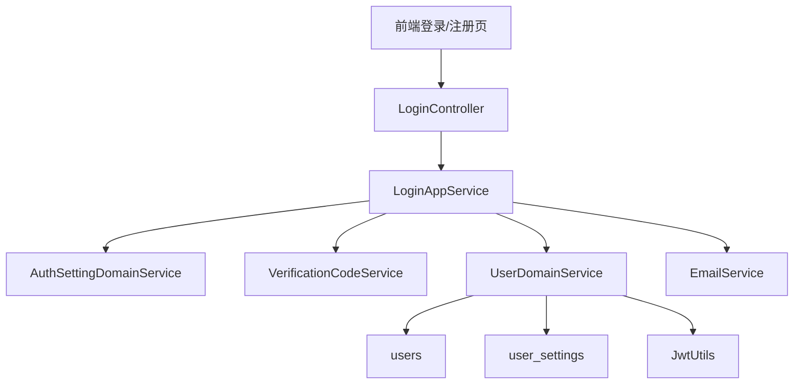
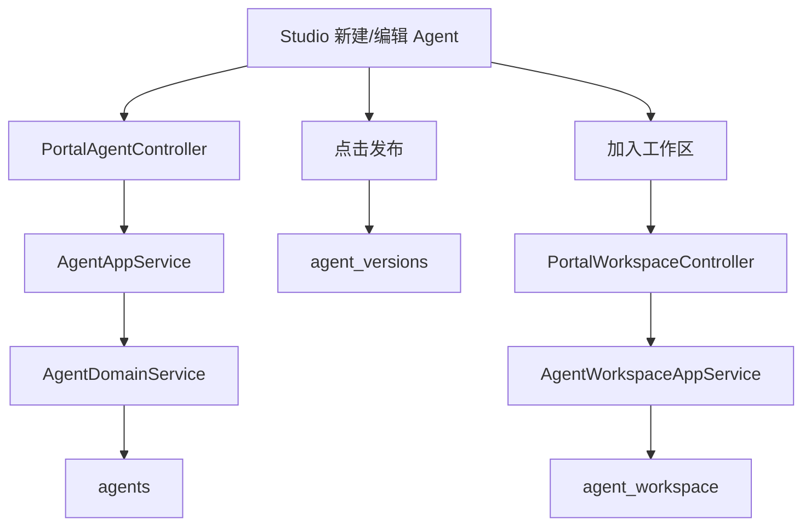
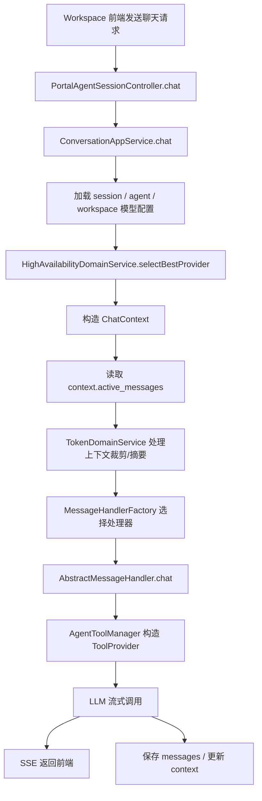
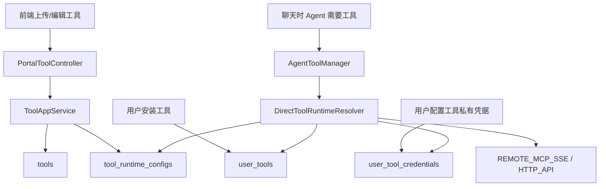
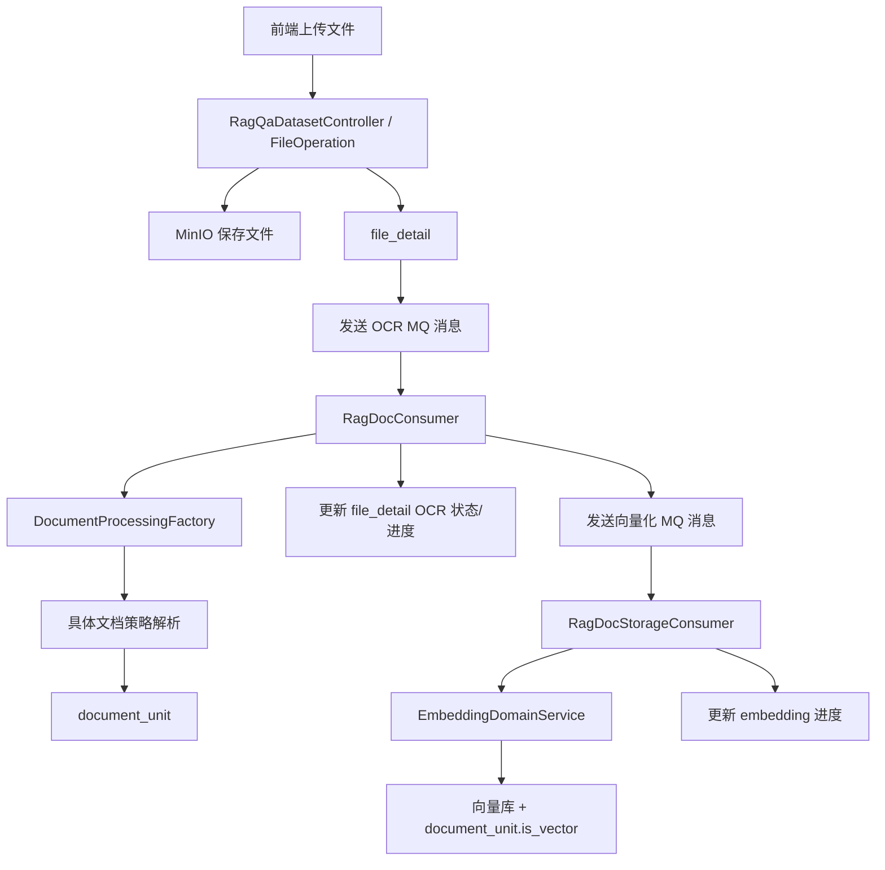
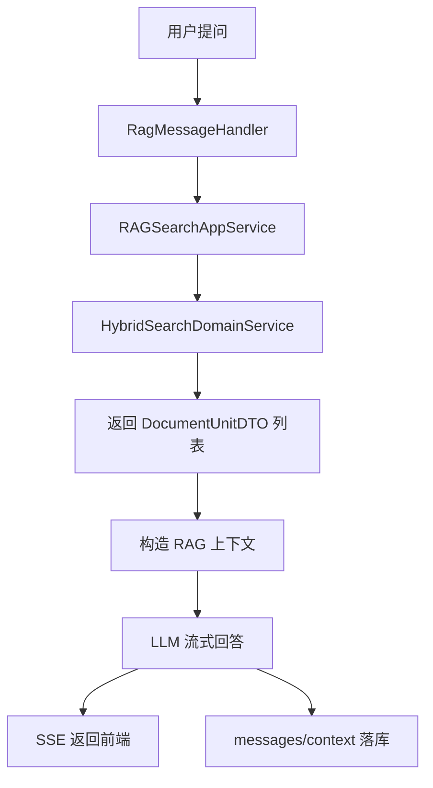
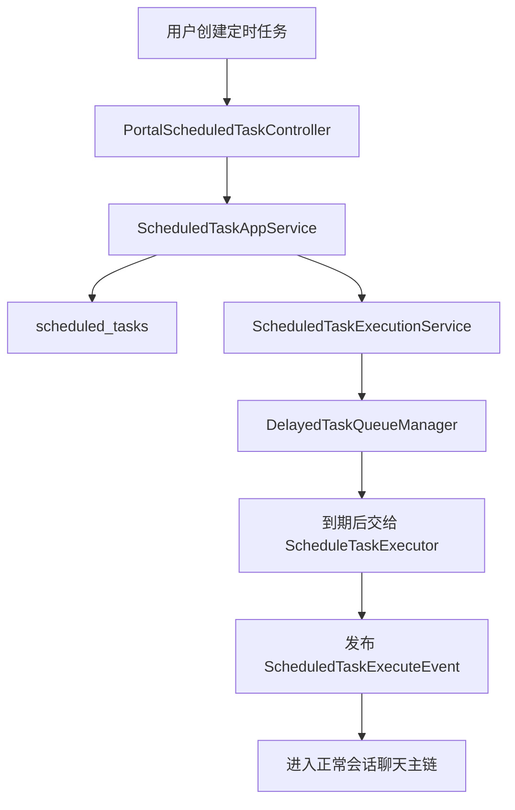
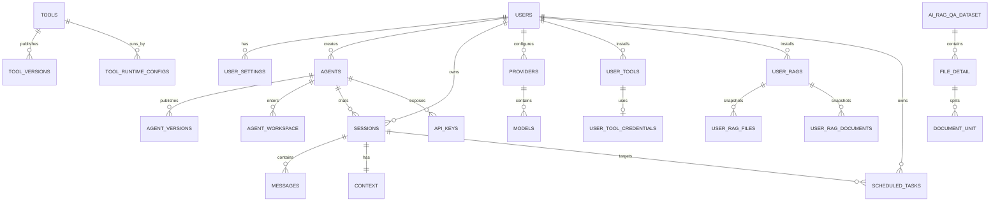

# AgentX 项目综述笔记

## 0. 说明

本文基于当前本地仓库 `/Users/liyoh/develop/developProject/AgentX` 的实际源码整理，目标不是做宣传，而是把这个项目当前版本的前端实现、后端主链、数据库设计、RAG/MCP/上下文/定时任务等核心能力讲清楚，便于后续学习、答辩、论文写作和继续补充。

当前判断依据主要来自：

- 后端源码：`AgentX/src/main/java/org/xhy`
- 前端源码：`agentx-frontend-plus/`
- 初始化 SQL：`docs/sql/01_init.sql`
- 本地启动入口：`deploy/start.sh`

一句话理解 AgentX：

```text
AgentX = 用户系统 + 模型服务商配置 + Agent 创建与发布 + 工作区会话聊天 + 工具/MCP 调用 + RAG 知识库 + API Key 开放接口 + 管理后台
```

这不是单一聊天页面，而是一个围绕 Agent 生命周期搭建出来的完整工程。

## 1. 项目定位

### 1.1 业务定位

AgentX 面向的不是“单次提问”，而是“用户自己配置模型、创建 Agent、给 Agent 接工具和知识库，再把它放到工作区长期使用”这一整套场景。

普通用户主链路可以概括为：

```text
注册/登录
-> 配置第三方模型服务商和模型
-> 创建 Agent
-> 绑定工具和知识库
-> 加入工作区
-> 创建会话并持续聊天
-> 通过 API Key 或定时任务扩展使用方式
```

管理员主链路可以概括为：

```text
登录后台
-> 管理用户
-> 管理服务商/模型
-> 审核 Agent 发布版本
-> 审核工具
-> 审核 RAG 知识库版本
-> 管理认证开关
```

### 1.2 当前版本的重要边界

当前代码里，下面这些判断是成立的：

- 前端主登录方式是邮箱/密码。
- 后端仍保留了 `SsoController`，但当前主流程不是靠 SSO 驱动。
- 工具运行已转成“远程 MCP SSE / HTTP API 直连”，不是本地为每个工具起容器。
- 聊天主链已经不再强调平台计费和余额扣减，核心放在消息、上下文、模型、工具和知识库增强。
- RAG 文件处理是异步链路，上传完成不等于 OCR、切分、向量化已经完成。

## 2. 运行结构与目录结构

### 2.1 运行结构

本地统一通过 Docker Compose 启动，入口脚本是：

```bash
./deploy/start.sh
```

关键服务如下：

- `agentx-backend`：Spring Boot 后端，默认宿主机端口 `8088`，上下文路径是 `/api`
- `agentx-frontend`：Next.js 前端，默认宿主机端口 `3000`
- `postgres`：业务库与 RAG 元数据
- `rabbitmq`：RAG OCR/向量化异步消息
- `minio`：S3 兼容对象存储
- `api-gateway`：模型高可用网关
- `adminer`：数据库可视化工具

典型访问地址：

- 前端：`http://localhost:3000`
- 后端：`http://localhost:8088/api`
- 健康检查：`http://localhost:8088/api/health`
- 高可用网关：`http://localhost:8081`
- Adminer：`http://localhost:8082`

### 2.2 目录结构

项目顶层最重要的目录：

- `AgentX/`：Java 后端主工程
- `agentx-frontend-plus/`：Next.js 前端主工程
- `deploy/`：本地 Docker Compose、`.env`、启动脚本
- `docker/`：前后端 Dockerfile
- `docs/sql/`：初始化建表 SQL
- `production/`：生产部署参考
- `docs/`：项目说明、SQL、综述类文档

### 2.3 后端目录结构

后端核心包在 `org.xhy` 下，采用很明显的分层结构：

- `interfaces`：接口层，Controller 和 DTO
- `application`：应用服务层，编排业务用例
- `domain`：领域层，实体、领域服务、仓储抽象、状态与规则
- `infrastructure`：基础设施层，MyBatis Plus 仓储实现、对象存储、邮件、MQ、LLM 协议、鉴权、异常处理

### 2.4 前端目录结构

前端采用 Next.js App Router：

- `app/(auth)`：登录、注册、重置密码
- `app/(main)`：主业务系统
- `components/`：UI 组件和业务组件
- `contexts/`：全局上下文，如工作区上下文
- `hooks/`：复用状态逻辑
- `lib/`：接口调用封装、流式请求、业务 service
- `types/`：类型定义

## 3. 后端总体架构

### 3.1 分层职责

后端的典型调用方向是：

```text
Controller
-> AppService
-> DomainService
-> Repository / Gateway / 外部适配器
```

各层职责可以这样理解：

- `Controller`：接 HTTP 请求，读取 `UserContext`，做最外层参数接收
- `AppService`：真正的业务编排入口，决定这次用例需要调哪些领域能力
- `DomainService`：表达业务规则、状态流转、对象合法性检查
- `Repository`：落库和查库
- `Gateway/Adapter`：访问外部模型网关、对象存储、MCP 端点、邮件服务等

### 3.2 当前代码里常见的设计模式

这套代码不是纯粹为了套概念，但里面确实用了很多很典型的工程模式：

- 分层架构：`interfaces -> application -> domain -> infrastructure`
- 模板方法模式：`AbstractMessageHandler`
- 工厂模式：`MessageHandlerFactory`、`DocumentProcessingFactory`、`EmbeddingModelFactory`
- 策略模式：文件解析策略、Token 溢出策略、模型协议适配、检索策略
- 状态机模式：`FileProcessingStateMachineService`
- 事件驱动：`ScheduledTaskExecuteEvent`、RAG MQ 事件
- 延迟队列：`DelayedTaskQueueManager`
- 装配器模式：各种 `Assembler`
- 网关模式：高可用网关、对象存储、远程工具调用

### 3.3 为什么这样分层

这套分层的直接收益是：

- Controller 不直接写复杂业务。
- 聊天、RAG、工具、定时任务这种复杂链路可以被应用层统一编排。
- 文件处理状态机、模型选择、工具运行时解析等逻辑不散在 Controller。
- 基础设施依赖可以被领域层通过接口或服务隔离。

## 4. 前端总体架构

### 4.1 路由层

前端关键页面如下：

#### 认证区

- `/login`
- `/register`
- `/reset-password`

#### 主业务区

- `/workspace`：工作区聊天主界面
- `/studio`：Agent 列表
- `/studio/new`：新建 Agent
- `/studio/edit/[id]`：编辑 Agent
- `/knowledge`：知识库首页
- `/knowledge/[id]`：知识库详情与文件管理
- `/tools`：工具中心
- `/tools/upload`：上传工具
- `/tools/edit/[id]`：编辑工具
- `/tools-market`：工具市场
- `/settings/profile`
- `/settings/providers`
- `/settings/api-keys`
- `/settings/general`
- `/admin/*`：后台管理

### 4.2 前端代码分工

前端不是把所有逻辑都塞到页面里，而是拆成几层：

- `page.tsx`：页面级组合
- `components/*`：表单、列表、弹窗、聊天面板、侧边栏等
- `hooks/*`：例如 `use-agent-edit`、`use-interruptable-chat`
- `lib/*.ts`：接口请求层，例如 `agent-session-service.ts`、`tool-service.ts`、`rag-dataset-service.ts`

### 4.3 前端与后端接口关系

前端主要通过 `httpClient` 请求后端 JSON 接口，通过 `stream-service.ts` 请求聊天 SSE 接口。

它的工作模式可以概括为：

```text
页面交互
-> hooks 管状态
-> lib/service 发 HTTP 请求
-> 后端返回 Result<T>
-> 页面按 DTO 更新状态
```

而聊天是另一条链：

```text
输入消息
-> stream-service.ts 发送 fetch POST
-> 后端返回 text/event-stream
-> parseSSEResponse 逐段解析 data:
-> ChatPanel 持续更新回答内容
```

### 4.4 几个关键页面的真实职责

#### `app/(main)/workspace/page.tsx`

这是聊天主入口，负责：

- 读取工作区上下文
- 拉取工作区 Agent
- 拉取某个 Agent 的会话列表
- 创建新会话
- 驱动 `ConversationList` 和 `ChatPanel`
- 打开模型选择弹窗
- 打开定时任务面板

#### `app/(main)/studio/edit/[id]/page.tsx`

这是 Agent 配置核心页面，负责：

- 拉取 Agent 详情
- 编辑基础信息、系统提示词、工具、知识库
- 发布版本
- 查看版本历史
- 删除 Agent

#### `app/(main)/knowledge/page.tsx`

知识库首页按“我创建的 / 我安装的 / 推荐的”三段组织，说明前端也把 RAG 区分成“创作者视角”和“使用者视角”。

#### `app/(main)/tools/page.tsx`

工具页同样按“我创建的 / 我安装的 / 推荐的”组织，说明工具市场也是“发布-安装-使用”的双视角系统。

## 5. 认证与用户模块

### 5.1 业务作用

这个模块负责账号体系和主业务的准入控制。没有它，后面的 Agent、工作区、模型、工具、知识库都无法按用户隔离。

### 5.2 前端页面与服务

前端相关页面在：

- `app/(auth)/login/page.tsx`
- `app/(auth)/register/page.tsx`
- `app/(auth)/reset-password/page.tsx`

前端会调用：

- `auth-config-service.ts`
- `user-service.ts`

前端进入登录页时，通常会先读 `/auth/config`，判断普通登录、注册是否启用。

### 5.3 后端接口入口

核心 Controller：

- `LoginController`
- `PortalUserController`
- `AuthConfigController`
- `AdminAuthSettingController`

`LoginController` 暴露的关键接口：

- `POST /login`
- `POST /register`
- `POST /get-captcha`
- `POST /send-email-code`
- `POST /send-reset-password-code`
- `POST /verify-email-code`
- `POST /reset-password`

### 5.4 主要调用链

#### 登录链

```text
LoginController.login
-> LoginAppService.login
-> AuthSettingDomainService.isFeatureEnabled(NORMAL_LOGIN)
-> UserDomainService.login
-> PasswordUtils.matches
-> JwtUtils.generateToken
-> 返回 token
```

#### 注册链

```text
LoginController.register
-> LoginAppService.register
-> AuthSettingDomainService.isFeatureEnabled(USER_REGISTER)
-> VerificationCodeService.verifyCode
-> UserDomainService.register
-> users 落库
-> user_settings 落库
```

### 5.5 详细业务逻辑

#### 登录

`LoginAppService.login` 先做业务开关判断，再进入 `UserDomainService.login`。

`UserDomainService.login` 做的事情是：

- 按邮箱或手机号查用户
- 使用 `PasswordUtils.matches` 校验密码
- 失败时抛 `BusinessException("账号密码错误")`

通过后，`JwtUtils.generateToken(userId)` 生成 JWT，前端一般保存在本地存储中，后续请求通过 `Authorization: Bearer ...` 带上。

#### 注册

`LoginAppService.register` 不是直接插用户，而是先做两层校验：

- 是否允许注册
- 如果是邮箱注册，验证码是否通过

真正落库在 `UserDomainService.register`：

- 组装 `UserEntity`
- 密码用 `PasswordUtils.encode` 加密
- 校验账号是否重复
- 自动生成昵称，例如 `agent-xxxxxxx`
- `userRepository.checkInsert(userEntity)`
- 再创建一条 `UserSettingsEntity`

这意味着注册不是只写一张表，而是至少写两张：

- `users`
- `user_settings`

#### 邮箱验证码

发送验证码链路：

```text
LoginController.sendEmailCode
-> 取客户端 IP
-> LoginAppService.sendEmailVerificationCode
-> UserDomainService.checkAccountExist
-> VerificationCodeService.generateCode
-> EmailService.sendVerificationCode
```

这里可以看出，验证码服务与邮件服务被拆开了：

- `VerificationCodeService` 负责验证码生成、过期、校验
- `EmailService` 负责发邮件

### 5.6 数据库设计

#### `users`

核心字段：

- `id`
- `nickname`
- `email`
- `phone`
- `password`
- `is_admin`
- `login_platform`
- `github_id`
- `avatar_url`

这张表是所有业务表的用户外键来源。

#### `user_settings`

核心字段：

- `user_id`
- `setting_config`

这张表不是附属信息那么简单，它实际上承载了默认模型、OCR 模型、Embedding 模型、降级链等用户运行配置。

#### `auth_settings`

核心字段：

- `feature_type`
- `feature_key`
- `enabled`
- `config_data`

当前初始化数据只保留：

- `NORMAL_LOGIN`
- `USER_REGISTER`

### 5.7 本模块的设计特点

- 登录开关不是写死在代码里，而是数据库配置驱动。
- 密码逻辑被封装在领域层，而不是 Controller 里直接处理。
- 注册自动补齐 `user_settings`，保证后续模型配置和运行配置有落点。

### 5.8 流程图



## 6. Agent 创建、版本发布与工作区

### 6.1 业务作用

Agent 是整个系统最核心的业务对象。没有 Agent，就没有工作区聊天、开放接口、定时任务、工具编排和知识库增强的载体。

### 6.2 前端页面与服务

前端相关页面：

- `/studio`
- `/studio/new`
- `/studio/edit/[id]`
- `/workspace`

关键前端服务：

- `agent-service.ts`
- `agent-session-service.ts`
- `agent-knowledge-base-service.ts`
- `use-agent-edit.ts`

### 6.3 后端接口入口

核心 Controller：

- `PortalAgentController`
- `PortalWorkspaceController`
- `PortalAgentSessionController`
- `AgentKnowledgeBaseController`
- `AdminAgentController`

`PortalAgentController` 负责：

- 创建 Agent
- 查详情
- 查用户自己的 Agent
- 更新 Agent
- 启停 Agent
- 删除 Agent
- 发布 Agent 版本
- 查询版本历史
- 生成系统提示词

`PortalWorkspaceController` 负责：

- 添加 Agent 到工作区
- 删除工作区 Agent
- 查询工作区 Agent 列表
- 设置工作区 Agent 的模型配置

### 6.4 Agent 的三层数据结构

这一块非常重要，不能只把 Agent 理解成一张表。

#### `agents`

表示“原始 Agent 主体”，包括：

- 名称、头像、描述
- `system_prompt`
- `welcome_message`
- `tool_ids`
- `knowledge_base_ids`
- `tool_preset_params`
- `enabled`
- `published_version`
- `multi_modal`

#### `agent_versions`

表示“发布出来的版本快照”，包括：

- `version_number`
- `change_log`
- `publish_status`
- `published_at`
- 版本时刻对应的工具、知识库、提示词快照

#### `agent_workspace`

表示“某个用户把某个 Agent 加进了自己的工作区”，包括：

- `agent_id`
- `user_id`
- `llm_model_config`

这说明系统把“创作态”和“使用态”分开了：

- `agents` 是创作态
- `agent_workspace` 是使用态
- `agent_versions` 是发布态

### 6.5 创建与编辑链路

```text
前端编辑页
-> agent-service.ts
-> PortalAgentController
-> AgentAppService
-> AgentDomainService
-> agents 落库
```

前端编辑页在 `studio/edit/[id]` 会把这些内容集中维护：

- 名称、描述、头像
- 系统提示词
- 欢迎语
- 工具列表
- 知识库列表
- 工具预设参数
- 多模态开关

### 6.6 发布链路

发布不是简单改个状态，而是生成版本快照：

```text
编辑页点击发布
-> PortalAgentController.publish
-> AgentAppService / 版本相关服务
-> 写 agent_versions
-> 管理员审核
-> published_version 更新到 agents
```

这里的工程含义是：

- 用户日常编辑的是 `agents`
- 对外分发和市场展示的是 `agent_versions`

### 6.7 工作区链路

工作区是实际使用 Agent 的地方。

用户把 Agent 放入工作区后，会新增 `agent_workspace` 记录。后续真正聊天时，系统会从这里读到用户对该 Agent 的模型配置覆盖项 `llm_model_config`。

### 6.8 流程图



## 7. 会话、聊天、上下文与执行主链

### 7.1 这是全项目最重要的主链

如果只挑一个模块深挖，优先级最高的就是这一块，因为它把：

- 用户会话
- Agent 配置
- 模型选择
- 上下文历史
- Token 控制
- 工具调用
- RAG 注入
- SSE 流式响应

全部串起来了。

### 7.2 前端入口

前端聊天主界面是 `app/(main)/workspace/page.tsx`。

它负责：

- 选择工作区 Agent
- 拉取会话列表
- 创建新会话
- 打开某个会话
- 驱动 `ChatPanel`
- 在聊天过程中支持中断
- 在聊天侧边同时打开定时任务功能

相关前端 service：

- `agent-session-service.ts`
- `stream-service.ts`
- `session-message-service.ts`

### 7.3 后端接口入口

聊天相关 Controller 是 `PortalAgentSessionController`。

关键接口：

- `GET /agents/sessions/{sessionId}/messages`
- `GET /agents/sessions/{agentId}`
- `POST /agents/sessions/{agentId}`
- `PUT /agents/sessions/{id}`
- `DELETE /agents/sessions/{id}`
- `POST /agents/sessions/chat`
- `POST /agents/sessions/preview`
- `POST /agents/sessions/{sessionId}/interrupt`

### 7.4 数据结构

聊天域最关键的三张表：

#### `sessions`

- 会话标题
- 所属用户
- 所属 Agent
- 是否归档
- 元数据

#### `messages`

- `session_id`
- `role`
- `content`
- `message_type`
- `token_count`
- `body_token_count`
- `provider`
- `model`
- `metadata`
- `file_urls`

#### `context`

- `session_id`
- `active_messages`
- `summary`

这三张表分工非常清晰：

- `sessions`：一个对话主题
- `messages`：具体消息历史
- `context`：当前窗口上下文裁剪结果

### 7.5 Controller 到 AppService 的主链

聊天入口：

```text
PortalAgentSessionController.chat
-> ConversationAppService.chat
-> prepareEnvironmentByRequestType / prepareEnvironmentWithModel
-> MessageHandlerFactory.getHandler
-> AbstractMessageHandler.chat
-> 具体 Handler 处理流式对话
```

`ConversationAppService.chat` 做了五件大事：

1. 准备对话环境 `ChatContext`
2. 获取传输方式 `MessageTransport`
3. 选择处理器
4. 执行聊天
5. 把会话注册到 `ChatSessionManager`，支持中断

### 7.6 `ConversationAppService` 具体做了什么

#### 第一步：加载会话和 Agent

- 从 `sessionDomainService.getSession(sessionId, userId)` 取会话
- 再根据 `session.agentId` 取 Agent
- 如果是别人发布的 Agent，还会把最新版本属性覆盖到运行时 Agent 上

#### 第二步：加载工具配置

它不是直接拿 `agents.tool_ids` 去调用，而是：

- 读 Agent 的 `toolIds`
- 通过 `UserToolDomainService.getInstallTool` 找到用户安装过的工具
- 再把这些工具映射成 `mcpServerNames`

这一步非常关键，因为运行时真正能用的不是“平台上的工具定义”，而是“用户已安装的工具实例”。

#### 第三步：加载模型配置

模型读取优先级是：

1. 外部 API 显式指定模型
2. 工作区 `llm_model_config.modelId`
3. 用户默认模型

也就是说，Agent 运行时最终拿到的模型，不一定是 Agent 创建时原始保存的那一个，而是会被工作区配置覆盖。

#### 第四步：高可用选择

`ConversationAppService` 会把模型交给 `HighAvailabilityDomainService.selectBestProvider(...)`。

高可用启用时：

- 会带上 `sessionId` 做会话亲和
- 会带上用户的 `fallbackChain` 做降级链
- 网关可能返回“更适合的 Provider 和 Model”

高可用未启用时：

- 直接退回模型自身绑定的 Provider

#### 第五步：构造 `ChatContext`

`ChatContext` 里会放：

- `sessionId`
- `userId`
- `userMessage`
- `agent`
- `originalModel`
- `model`
- `originalProvider`
- `provider`
- `llmModelConfig`
- `mcpServerNames`
- `fileUrls`
- `instanceId`

这相当于一次对话运行时的完整执行上下文。

### 7.7 上下文与 Token 控制

`ConversationAppService.setupContextAndHistory` 的逻辑非常关键。

它会：

- 按 `sessionId` 查 `context`
- 如果已有上下文，就读取 `active_messages`
- 再批量查出这些 `messages`
- 对历史消息应用 Token 溢出策略

Token 溢出策略核心在 `applyTokenOverflowStrategy(...)`：

- 读 `LLMModelConfig.strategyType`
- 构造 `TokenOverflowConfig`
- 调 `TokenDomainService.processMessages`
- 若发生摘要，会把摘要写回 `context.summary`
- 最终重写 `context.active_messages`

这意味着上下文不是“每次把全量消息发给模型”，而是“从 message 全历史中裁剪一份活动窗口”。

### 7.8 `AbstractMessageHandler` 的模板方法

`AbstractMessageHandler` 是聊天框架的核心抽象。

它的 `chat(...)` 固定流程是：

1. 创建 SSE 或同步连接
2. 执行开始钩子
3. 创建用户消息和 LLM 消息实体
4. 初始化聊天内存
5. 构建历史消息
6. 根据子类决定是否提供工具
7. 选择流式或同步方式处理

这是典型模板方法模式。

子类只需要关心：

- 要不要工具
- 用什么系统提示
- 是否要做 RAG 检索

### 7.9 `AgentMessageHandler`

默认聊天处理器是 `AgentMessageHandler`。

它的职责相对克制，只做一件关键事：

- 通过 `AgentToolManager` 构造 `ToolProvider`

也就是说，复杂度不在它自己身上，而在它调用的工具运行时解析器上。

### 7.10 工具调用如何插入聊天

`AgentToolManager.createToolProvider(...)` 会遍历 `mcpServerNames`，逐个解析运行方式：

- 如果是 `HTTP_API`，用 `HttpApiToolProviderFactory`
- 如果是 `REMOTE_MCP_SSE`，用 `RemoteMcpToolProviderFactory`

运行时配置的来源不是内存，而是数据库：

- `user_tools`
- `tool_runtime_configs`
- `user_tool_credentials`

### 7.11 消息怎么落库

流式链里，用户消息和 AI 消息不是最后一次性一起存，而是分阶段：

1. 先保存用户消息并更新 context
2. 模型流式返回过程中不断向前端推送片段
3. 完整结束后更新用户消息 token
4. 保存 AI 消息
5. 更新 context 中 active messages

所以数据库里的 `messages` 是“用户消息先落，AI 消息后补”。

### 7.12 会话中断

Controller 中断接口：

```text
POST /agents/sessions/{sessionId}/interrupt
-> ChatSessionManager.interruptSession(sessionId)
```

本质是运行时维持一层会话到 emitter/stream 的映射。

### 7.13 主流程图



## 8. 模型服务商、模型配置与高可用网关

### 8.1 业务作用

这一块决定“聊天到底连哪个模型、用哪个 key、走哪个 provider、失败后怎么切换”。

### 8.2 前端页面与服务

主要前端页面：

- `/settings/providers`
- Agent 工作区里的模型选择弹窗

关键前端服务：

- `user-settings-service.ts`
- `api-services.ts`
- 与模型相关的 `lib` service

### 8.3 后端接口入口

门户侧入口是 `PortalLLMController`：

- `GET /llms/providers`
- `POST /llms/providers`
- `PUT /llms/providers`
- `POST /llms/providers/{providerId}/status`
- `DELETE /llms/providers/{providerId}`
- `GET /llms/providers/protocols`
- `POST /llms/models`
- `PUT /llms/models`
- `DELETE /llms/models/{modelId}`
- `PUT /llms/models/{modelId}/status`
- `GET /llms/models`
- `GET /llms/models/default`

### 8.4 数据库设计

#### `providers`

核心字段：

- `protocol`
- `name`
- `config`
- `is_official`
- `status`

`config` 是加密后的服务商配置文本，里面会存 API Key、Base URL 等。

#### `models`

核心字段：

- `provider_id`
- `model_id`
- `model_endpoint`
- `type`
- `status`

说明系统区分：

- 模型展示名 `name`
- 模型协议 ID `model_id`
- 真实请求端点/模型端点 `model_endpoint`

### 8.5 应用层逻辑

`LLMAppService` 的作用不是调用模型，而是管理 Provider 和 Model：

- 创建服务商
- 更新服务商
- 创建模型
- 更新模型
- 给没有默认模型的用户自动设置默认模型

这里的一个工程细节是：

- 编辑 Provider 时，如果前端传回的是掩码 `*****`，会保留原始 API Key，不会把掩码写进库里

### 8.6 高可用逻辑

真正聊天时不是直接拿 `model.providerId` 去请求，而是先经过 `HighAvailabilityDomainServiceImpl`。

如果高可用关闭：

- 直接返回原模型和原服务商

如果高可用开启：

- 调高可用网关选实例
- 支持 `sessionId` 亲和
- 支持 fallback chain
- 可能切换到另一个模型实例

聊天完成后，还会异步调用：

```text
reportCallResult(instanceId, modelId, success, latency, errorMessage)
```

用于把调用结果上报给网关。

### 8.7 这一层的工程意义

这一层把“用户自配模型”和“运行时稳定性控制”分开了：

- `providers` / `models` 解决“用什么模型”
- 高可用网关解决“实际这次请求该落到哪个实例”

## 9. 工具市场、远程 MCP 与 HTTP API 工具

### 9.1 业务作用

工具模块负责把 Agent 从“只能聊天”扩展到“能调用外部能力”。

它支持两类运行时：

- 远程 MCP SSE
- HTTP API

### 9.2 前端页面与服务

前端页面：

- `/tools`
- `/tools/upload`
- `/tools/edit/[id]`
- `/tools-market`

关键前端服务：

- `tool-service.ts`
- `app/(main)/tools/hooks/*`
- `app/(main)/tools/utils/tool-service.ts`

前端页面结构本身也说明了业务分层：

- 我创建的工具
- 我安装的工具
- 推荐工具

### 9.3 后端接口入口

门户侧入口是 `PortalToolController`。

关键接口：

- `POST /tools`
- `POST /tools/runtime/probe`
- `GET /tools/{toolId}`
- `GET /tools/user`
- `PUT /tools/{toolId}`
- `DELETE /tools/{toolId}`
- `POST /tools/market`
- `GET /tools/market`
- `GET /tools/market/{toolId}/{version}`
- `POST /tools/install/{toolId}/{version}`
- `POST /tools/uninstall/{toolId}`
- `GET /tools/installed`
- `PUT /tools/installed/{userToolId}/credential`
- `GET /tools/recommend`

### 9.4 关键数据表

#### `tools`

表示用户创建的原始工具主体，核心字段：

- `name`
- `description`
- `tool_type`
- `upload_type`
- `tool_list`
- `mcp_server_name`
- `runtime_type`
- `status`
- `is_global`

#### `tool_versions`

表示发布版本快照，和 Agent 版本类似。

#### `user_tools`

表示“某个用户安装了某个工具版本”，这是运行时真正查的表。

关键字段：

- `tool_id`
- `version`
- `mcp_server_name`
- `runtime_type`
- `credential_required`
- `credential_configured`

#### `tool_runtime_configs`

这是运行时配置核心表，决定工具怎么被调用。

关键字段：

- `runtime_type`
- `transport_type`
- `endpoint_url`
- `http_method`
- `auth_type`
- `auth_config_schema`
- `default_headers`
- `request_schema`
- `response_schema`
- `tool_definitions`
- `mcp_server_name`

#### `user_tool_credentials`

保存用户自己的私有鉴权参数：

- `user_tool_id`
- `tool_id`
- `auth_values`

### 9.5 创建和探测链路

工具创建不是直接存个名字就结束，而是通常要先探测端点：

```text
前端填写远程端点
-> POST /tools/runtime/probe
-> ToolEndpointProbeService
-> 探测端点返回的工具定义
-> 保存到 tool_runtime_configs.tool_definitions
```

### 9.6 安装与运行链路

聊天时工具不是直接从 `tools` 查，而是走运行时解析器：

```text
ConversationAppService
-> UserToolDomainService 获取已安装工具
-> AgentToolManager
-> DirectToolRuntimeResolver.resolve(serverName, userId)
-> 读取 user_tools
-> 读取 tool_runtime_configs
-> 读取 user_tool_credentials
-> 根据 runtime_type 选择 HTTP_API 或 REMOTE_MCP_SSE
```

这一步说明一个重要设计思想：

- 发布市场中的工具只是“定义”
- 安装后的 `user_tools` 才是“当前用户可运行的工具实例”

### 9.7 `AgentToolManager` 的价值

`AgentToolManager` 做了三个关键动作：

1. 解析每个工具的运行方式
2. 构造 LangChain4j 可用的 `ToolProvider`
3. 包一层失败保护，避免工具挂掉后模型无限重试

它在 `wrapToolExecutors(...)` 里把执行异常转换成一段明确文本，让模型知道：

- 工具失败了
- 不要一直重复调用
- 应该转而向用户解释工具不可用

这是一种很实用的 Agent 工程手法。

### 9.8 工具模块流程图



## 10. 知识库、RAG 检索与异步文件处理

### 10.1 业务作用

RAG 模块负责让 Agent 不只依赖模型参数和上下文历史，还能利用用户上传或安装的知识库进行检索增强。

它实际上包含两条链：

- 离线链：上传文件 -> OCR/切分 -> 向量化 -> 入库
- 在线链：提问 -> 检索 -> 组装上下文 -> 生成回答

### 10.2 前端页面与服务

前端页面：

- `/knowledge`
- `/knowledge/[id]`

关键前端 service：

- `rag-dataset-service.ts`
- `rag-file-service.ts`
- `rag-file-detail.service.ts`
- `rag-chat-service.ts`

知识库首页把数据分为：

- 我创建的知识库
- 我安装的知识库
- 推荐知识库

这和工具模块是同一类市场化设计。

### 10.3 后端接口入口

核心 Controller：

- `RagQaDatasetController`
- `FileOperationController`
- `RagPublishController`
- `RagMarketController`
- `RagSearchController`
- `AdminRagReviewController`

关键接口大致分成几类：

#### 数据集管理

- `POST /rag/datasets`
- `PUT /rag/datasets/{datasetId}`
- `DELETE /rag/datasets/{datasetId}`
- `GET /rag/datasets/{datasetId}`

#### 文件管理与处理

- `POST /rag/datasets/files`
- `POST /rag/datasets/files/process`
- `POST /rag/datasets/files/reprocess`
- `GET /rag/datasets/files/{fileId}/progress`
- `GET /rag/files/{fileId}/info`
- `POST /rag/files/document-units/list`

#### 检索与问答

- `POST /rag/search`
- `POST /rag/search/stream-chat`
- `POST /rag/search/user-rag/{userRagId}`
- `POST /rag/search/user-rag/{userRagId}/stream-chat`

#### 发布与安装

- `POST /rag/publish`
- `GET /rag/publish/versions`
- `GET /rag/market`
- `POST /rag/market/install`
- `DELETE /rag/market/uninstall/{ragVersionId}`

### 10.4 数据模型

#### 原始数据集侧

- `ai_rag_qa_dataset`
- `file_detail`
- `document_unit`
- `rag_versions`
- `rag_version_files`
- `rag_version_documents`

#### 用户安装侧

- `user_rags`
- `user_rag_files`
- `user_rag_documents`

这说明系统把“我创建的原始知识库”和“我安装的知识库副本/引用”区分开了。

### 10.5 创建数据集链路

`RagQaDatasetAppService.createDataset` 做的事情不只是创建数据集：

1. 创建 `ai_rag_qa_dataset`
2. 自动发布一个 `0.0.1` 版本
3. 自动安装给创建者自己

也就是说，用户一创建知识库，系统就把它放进“可安装、可使用”的体系里了。

### 10.6 文件上传与异步处理链路

文件上传成功后，系统不会同步完成整个处理过程。

完整链路是：

```text
前端上传文件
-> 保存对象存储文件
-> 写 file_detail
-> 发送 OCR MQ 消息
-> RagDocConsumer 消费
-> DocumentProcessingFactory 选具体文档处理策略
-> 生成 document_unit
-> 更新 OCR 进度与状态
-> 自动发送向量化 MQ 消息
-> RagDocStorageConsumer 消费
-> EmbeddingDomainService.syncStorage
-> 写向量与 is_vector 状态
-> 更新 embedding 进度
-> file_detail 状态变成 COMPLETED
```

### 10.7 `file_detail` 为什么这么重要

`file_detail` 不是一个简单文件表，它是整个文件处理状态中心。

关键字段：

- `data_set_id`
- `file_page_size`
- `current_ocr_page_number`
- `current_embedding_page_number`
- `ocr_process_progress`
- `embedding_process_progress`
- `processing_status`

这里的 `processing_status` 明确区分：

- `0` 已上传
- `1` OCR 处理中
- `2` OCR 完成
- `3` 向量化处理中
- `4` 处理完成
- `5` OCR 失败
- `6` 向量化失败

### 10.8 状态机设计

文件状态不是随便改整数，而是通过 `FileProcessingStateMachineService` 管控。

它处理的事件包括：

- `START_OCR_PROCESSING`
- `COMPLETE_OCR_PROCESSING`
- `FAIL_OCR_PROCESSING`
- `START_EMBEDDING_PROCESSING`
- `COMPLETE_EMBEDDING_PROCESSING`
- `FAIL_EMBEDDING_PROCESSING`
- `RESET_PROCESSING`
- 进度更新事件

这是标准状态机模式。

### 10.9 OCR 消费者 `RagDocConsumer`

它的工作过程：

1. 从 MQ 中取 `RagDocMessage`
2. 把 `file_detail` 状态切到 OCR 处理中
3. 根据文件扩展名交给 `DocumentProcessingFactory`
4. 由具体 `DocumentProcessingStrategy` 解析 PDF/Word/TXT 等
5. 生成 `document_unit`
6. 更新 OCR 进度和 OCR 完成状态
7. 自动触发向量化消息

### 10.10 向量化消费者 `RagDocStorageConsumer`

它负责：

1. 接收 `RagDocSyncStorageMessage`
2. 调 `EmbeddingDomainService.syncStorage`
3. 把文档单元向量化
4. 更新当前文件的向量化进度
5. 所有页面完成后，把文件标记为处理完成

### 10.11 在线检索链路

用户提问时，RAG 不是直接拼字符串，而是：

```text
RagSearchController / RagMessageHandler
-> RAGSearchAppService
-> 校验数据集或已安装知识库权限
-> 获取用户 Embedding 模型配置
-> 获取用户 Chat 模型配置（用于 HyDE）
-> HybridSearchDomainService.hybridSearch
-> 返回 DocumentUnitDTO 列表
```

### 10.12 `RagMessageHandler`

这个处理器是聊天链里的 RAG 特化版本。

它把一次问答拆成两阶段：

1. 先检索文档
2. 再基于检索文档生成回答

同时它会向前端发送不同消息类型：

- `RAG_RETRIEVAL_START`
- `RAG_RETRIEVAL_END`
- `RAG_THINKING_START`
- `RAG_THINKING_PROGRESS`
- `RAG_ANSWER_PROGRESS`
- `RAG_ANSWER_END`

所以前端可以做成比普通聊天更细粒度的 RAG 展示体验。

### 10.13 用户安装知识库的 REFERENCE / SNAPSHOT

`user_rags.install_type` 非常关键，有两种语义：

- `REFERENCE`：引用原始知识库
- `SNAPSHOT`：安装时做快照隔离

为了支持快照隔离，系统又准备了：

- `user_rag_files`
- `user_rag_documents`

也就是说，知识库市场不只是“装个 ID”，而是支持“引用式安装”和“快照式安装”两种策略。

### 10.14 RAG 主流程图



### 10.15 在线问答流程图



## 11. 定时任务模块

### 11.1 业务作用

这个模块允许用户给某个 Agent 的某个会话绑定周期任务，让系统在指定时间自动往这个会话里发一条消息，再复用正常聊天链生成结果。

它本质上不是单独做一个“脚本执行系统”，而是“把定时调度接入会话聊天主链”。

### 11.2 前端入口

前端入口在工作区页，`workspace/page.tsx` 中集成了 `ScheduledTaskPanel`。

也就是说，定时任务是会话的附属能力，而不是单独一套系统。

### 11.3 后端接口入口

Controller：`PortalScheduledTaskController`

关键接口：

- `POST /scheduled-tasks`
- `PUT /scheduled-tasks/{taskId}`
- `DELETE /scheduled-tasks/{taskId}`
- `GET /scheduled-tasks`
- `GET /scheduled-tasks/agent/{agentId}`
- `GET /scheduled-tasks/{taskId}`
- `POST /scheduled-tasks/{taskId}/pause`
- `POST /scheduled-tasks/{taskId}/resume`

### 11.4 数据库设计

核心表是 `scheduled_tasks`。

关键字段：

- `user_id`
- `agent_id`
- `session_id`
- `content`
- `repeat_type`
- `repeat_config`
- `status`
- `last_execute_time`
- `next_execute_time`

这张表已经足够表达：

- 给谁执行
- 对哪个 Agent 执行
- 往哪个会话里投递消息
- 什么时候执行
- 执行到哪一步

### 11.5 后端主链

创建任务：

```text
PortalScheduledTaskController.createScheduledTask
-> ScheduledTaskAppService.createScheduledTask
-> ScheduledTaskAssembler.toEntity
-> TaskScheduleService.calculateNextExecuteTime
-> ScheduledTaskDomainService.createTask
-> ScheduledTaskExecutionService.scheduleTask
```

### 11.6 DelayQueue 方案

这里没有直接上 Quartz，而是自己实现了一套轻量调度：

- `ScheduledTaskExecutionService`
- `DelayedTaskQueueManager`
- `ScheduleTaskExecutor`

`DelayedTaskQueueManager` 内部维护：

- `DelayQueue<DelayedTaskItem>`
- 消费线程
- 线程池

到期后，它会把任务扔给 `ScheduleTaskExecutor.executeTask(...)`。

### 11.7 为什么这套设计合理

因为这个功能的目标不是做大型分布式任务系统，而是：

- 在单体系统内按时间触发会话消息
- 触发后仍然复用现有聊天主链

所以 DelayQueue 足够简单直接。

### 11.8 执行事件桥接

`ScheduleTaskExecutor` 不直接写聊天逻辑，而是发布：

```text
ScheduledTaskExecuteEvent
```

然后由应用层监听这个事件，再进入正常会话聊天链。

这是一种典型解耦手法：

- 调度层负责“什么时候执行”
- 会话层负责“执行时怎么聊天”

### 11.9 流程图



## 12. API Key 与开放接口

### 12.1 业务作用

这个模块允许外部系统不通过前端页面，而是通过 API Key 直接调用 Agent。

### 12.2 接口入口

门户管理接口：

- `PortalApiKeyController`

开放接口：

- `OpenController`

`OpenController` 的关键接口：

- `POST /v1/chat/completions`
- `GET /v1/models`
- `GET /v1/sessions`
- `POST /v1/sessions`
- `DELETE /v1/sessions/{id}`

这说明系统对外暴露的是“兼容 OpenAI Chat Completions 风格”的使用方式。

### 12.3 数据库设计

核心表是 `api_keys`。

关键字段：

- `api_key`
- `agent_id`
- `user_id`
- `status`
- `usage_count`
- `last_used_at`
- `expires_at`

这里的设计意味着 API Key 是直接绑定 Agent 的，不是全局万能 Key。

## 13. 管理后台模块

### 13.1 前端页面

后台页面在：

- `/admin`
- `/admin/users`
- `/admin/agents`
- `/admin/providers`
- `/admin/tools`
- `/admin/tools/upload`
- `/admin/rags`
- `/admin/auth-settings`

### 13.2 后端控制器

- `AdminUserController`
- `AdminAgentController`
- `AdminLLMController`
- `AdminToolController`
- `AdminRagReviewController`
- `AdminAuthSettingController`

### 13.3 管理后台的真实价值

后台不是附属页面，而是平台治理中枢。它控制：

- 用户列表
- Agent 发布审核
- 工具审核与官方化
- 模型与服务商维护
- RAG 审核
- 认证方式开关

## 14. 数据库全局设计

### 14.1 按业务域划分

#### 用户与认证域

- `users`
- `user_settings`
- `auth_settings`

#### Agent 域

- `agents`
- `agent_versions`
- `agent_workspace`
- `agent_tasks`

#### 会话与消息域

- `sessions`
- `messages`
- `context`

#### 模型域

- `providers`
- `models`

#### 工具域

- `tools`
- `tool_versions`
- `user_tools`
- `tool_runtime_configs`
- `user_tool_credentials`

#### RAG 域

- `ai_rag_qa_dataset`
- `file_detail`
- `document_unit`
- `rag_versions`
- `rag_version_files`
- `rag_version_documents`
- `user_rags`
- `user_rag_files`
- `user_rag_documents`

#### 定时任务域

- `scheduled_tasks`

#### 开放接口域

- `api_keys`

### 14.2 关键关系



### 14.3 几个设计上的重点

#### 重点一：JSONB 用得很多

系统大量使用 JSON/JSONB 字段，例如：

- `agents.tool_ids`
- `agents.knowledge_base_ids`
- `agents.tool_preset_params`
- `context.active_messages`
- `providers.config`
- `agent_workspace.llm_model_config`
- `tool_runtime_configs.auth_config_schema`
- `scheduled_tasks.repeat_config`

这说明项目里有不少“弱结构、易变结构”的配置型数据。

#### 重点二：运行态与发布态分离

以下模块都有“主对象”和“版本/安装态”的分离：

- Agent：`agents` / `agent_versions` / `agent_workspace`
- Tool：`tools` / `tool_versions` / `user_tools`
- RAG：`ai_rag_qa_dataset` / `rag_versions` / `user_rags`

这是整个系统最重要的架构思想之一。

#### 重点三：会话上下文不是直接靠 messages 全量回放

`context` 单独存在，说明系统已经考虑：

- 历史过长
- Token 限制
- 摘要压缩

所以 `messages` 负责全量历史，`context` 负责当前窗口。

## 15. 这套系统最值得抓住的主干

如果后续要继续学习、答辩或写论文，优先抓这几条主链：

1. 用户注册/登录 -> `users` / `user_settings`
2. Agent 创建/发布/加入工作区 -> `agents` / `agent_versions` / `agent_workspace`
3. 会话聊天 -> `sessions` / `messages` / `context`
4. 模型配置与高可用 -> `providers` / `models`
5. 工具运行时 -> `user_tools` / `tool_runtime_configs` / `user_tool_credentials`
6. RAG 离线处理与在线检索 -> `file_detail` / `document_unit` / `user_rags`
7. 定时任务复用聊天主链 -> `scheduled_tasks`

## 16. 当前文档还可以继续补的方向

这版已经把主业务链、主要表和复杂流程图补到了可以直接用于学习和答辩梳理的程度，但如果继续深挖，下一轮最值得补的是：

- 每个 Controller 的完整接口清单与参数 DTO
- `AgentAppService`、`ToolAppService`、`RagMarketAppService` 的逐方法解释
- 前端各页面组件树和状态流
- `HybridSearchDomainService`、`HyDEDomainService`、`RerankDomainService` 的更细实现
- 后端 `Repository` 与 MyBatis Plus 实体映射关系

这份文件后续可以继续作为长期笔记累加，不需要再重新起一份。
