# AgentX 项目学习笔记

> 这是一份按照“从上到下读就能逐步建立项目脑图”的学习书稿。  
> 它的目标不是列路线，而是把 AgentX 的运行环境、前端页面、后端业务、Agent 执行、RAG、MCP 工具、数据库和中间件逐层讲清楚。  
> 本文只基于当前仓库源码与 `docs/项目综述笔记.md` 做学习整理，不做代码运行验证。

## 0. 阅读方法

### 0.1 你读完后应该达到什么程度

读完本文，你应该能做到四件事：

第一，看到一个页面时，能知道它大概率在 `agentx-frontend-plus/app` 的哪个路由下，页面会组合哪些 `components`，会调用 `lib/*-service.ts` 里的哪些接口函数，最后落到后端哪个 Controller。

第二，看到一个后端请求时，能从 Controller 往下追到 AppService、DomainService、Repository、Entity 和数据库表。例如聊天请求不是只到 `PortalAgentSessionController`，而是会进入 `ConversationAppService`，再选择 `MessageHandlerFactory`，再进入 `AbstractMessageHandler` 模板流程，最后调用模型、工具、RAG、消息落库和 SSE 返回。

第三，看到 Agent/RAG/MCP 相关代码时，能知道它们不是三个孤立功能，而是同一条“智能体执行链”的不同增强能力：Agent 负责角色和任务，RAG 负责把知识库片段塞进上下文，MCP/HTTP 工具负责让模型调用外部能力。

第四，看到部署配置时，能知道每个中间件服务为什么存在：PostgreSQL 保存业务数据，pgvector 支撑向量检索，RabbitMQ 承接异步文件处理，MinIO/S3 保存上传文件，Docker Compose 把后端、前端和中间件组织成一套本地环境。

### 0.2 本文的学习顺序

不要从 `src/main/java` 直接乱翻。AgentX 文件多，如果先从某个类开始，很容易只记住局部实现，却不知道它在系统里的位置。

本文顺序固定为：

1. 先看项目全局地图，知道有哪些目录和运行部件。
2. 再看前端最小知识，因为你前端基础较少，必须先知道页面、组件、service、hook、type 分别是什么。
3. 再看后端分层，因为你有 Java 后端基础，只需要把这个项目的业务分层和命名习惯建立起来。
4. 再看认证、Agent、会话聊天主链。聊天主链是全项目核心。
5. 再看模型、高可用、MCP 工具、RAG。它们都服务于聊天主链。
6. 最后看定时任务、API Key、管理后台、数据库、MQ、异常和逐文件索引。

每一章都先讲“业务上它解决什么问题”，再讲“前端在哪”，再讲“后端从入口到落库怎么走”。这样你从上到下读，不需要反复跳页。

### 0.3 读代码时的统一模板

以后你学习每个文件，都按下面模板记录：

```text
文件路径：
所属模块：
所属层级：Controller / AppService / DomainService / Repository / Entity / Infrastructure / Frontend Page / Frontend Service / Component / Hook
业务作用：
上游是谁调用它：
下游它调用谁：
关键方法：
关键变量：
关联数据表：
容易误解的地方：
我是否能复述：
```

这个模板很重要。你最终要形成的是一张脑图，而不是一堆零散注释。

## 1. 项目全局地图

### 1.1 AgentX 到底是什么

AgentX 是一个 AI Agent 平台。用户可以创建 Agent，配置它的名称、描述、系统提示词、模型、工具、知识库和定时任务，然后在工作区里和 Agent 对话，也可以把 Agent 通过 API Key 暴露给外部系统调用。

这个项目的主线可以压缩成一句话：

```text
用户创建 Agent -> 配置模型/工具/知识库 -> 创建会话 -> 发送消息 -> 后端装配上下文 -> 调用模型 -> 模型可能调用工具或检索知识库 -> 流式返回 -> 消息和上下文落库
```

你后续读任何模块，都要问它在这条链上负责哪一步。

### 1.2 仓库一级目录

```text
AgentX/
  AgentX/                    后端 Spring Boot 项目
  agentx-frontend-plus/       前端 Next.js 项目
  deploy/                     本地 Docker Compose 启动目录
  docker/                     后端/前端镜像构建文件
  docs/                       项目文档和初始化 SQL
  production/                 生产部署参考
  学习笔记.md                 本文
```

`AgentX/` 这个名字在仓库里出现两层：外层是整个项目根目录，内层 `AgentX/` 是后端模块。以后说“后端目录”时，指的是 `AgentX/src/main/java/org/xhy`。

### 1.3 整体运行脑图

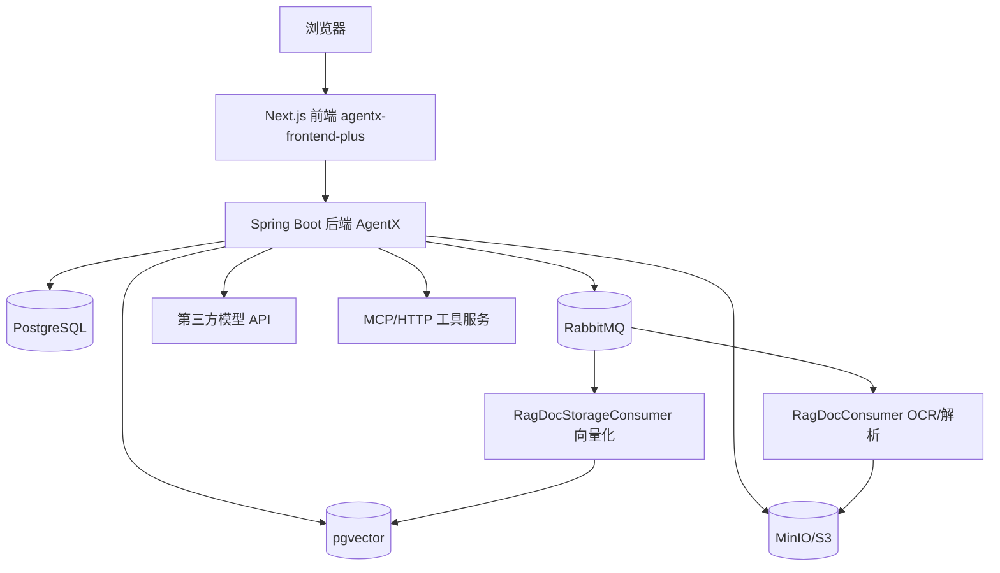

你可以先把 AgentX 理解成“前端 + 后端 + 数据库 + 模型 API + 工具运行 + 知识库异步处理”。

### 1.4 后端四层脑图

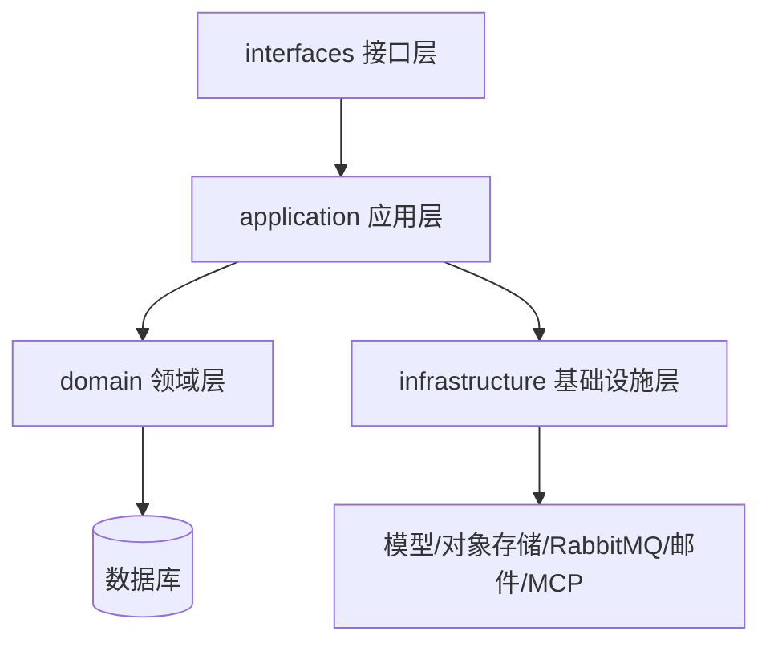

四层职责：

- `interfaces`：只管 HTTP 入口和 DTO。Controller 不应该装太多业务。
- `application`：把多个领域服务、基础设施服务串起来，形成一个完整用例。
- `domain`：表达真正的业务对象、业务规则、状态机和数据库仓储。
- `infrastructure`：对接外部技术能力，例如 LLM、MQ、OSS、SSE、JWT、邮件、RAG 解析器。

### 1.5 前端四类文件脑图

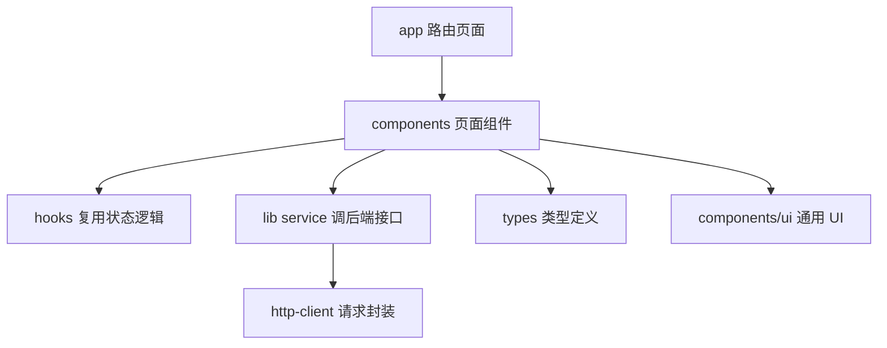

前端你先记住一句话：`app` 决定“页面在哪”，`components` 决定“页面长什么样”，`lib` 决定“怎么调接口”，`hooks` 决定“复杂交互状态怎么复用”，`types` 决定“数据长什么样”。

## 2. 运行环境与中间件

### 2.1 先认识启动文件

`deploy/start.sh` 是本地启动的主要入口。它不是业务代码，而是把 Docker Compose 命令包装起来，让本地一次性启动前端、后端和中间件。

`deploy/docker-compose.yml` 是本地运行拓扑。你读它时不要只看服务名，要看三类内容：

1. 容器镜像或构建路径：哪些服务从本地代码 build，哪些服务直接拉官方镜像。
2. 端口映射：浏览器和本机工具从哪个端口访问。
3. 环境变量：后端连接数据库、RabbitMQ、MinIO、模型服务时需要哪些变量。

`deploy/.env` 是本地 Compose 的主要变量来源。它和根目录 `.env` 不要混淆。当前本地 Docker Compose 启动时，重点看 `deploy/.env`。

`docker/backend/Dockerfile` 和 `docker/backend/Dockerfile.dev` 负责后端镜像构建。你只要知道：Dockerfile 把 Java 后端打成容器运行，开发版可能更偏向本地调试或构建缓存。

`docker/frontend/Dockerfile` 和 `docker/frontend/Dockerfile.dev` 负责前端镜像构建。Next.js 前端最终也会作为容器服务运行。

`production/docker-compose.yml` 是生产部署参考。学习时先不深入，等你理解本地 Compose 后再看生产文件有什么差别。

### 2.2 PostgreSQL 与 pgvector

PostgreSQL 是主数据库。用户、Agent、会话、消息、工具、知识库、API Key、定时任务都存在这里。

pgvector 是 PostgreSQL 的向量扩展。RAG 文件被切成片段后，会生成 embedding 向量，向量检索就是在 pgvector 上完成的。你学习 RAG 时要把 `document_unit` 理解成“可被检索的知识片段”，把向量字段理解成“语义检索用的坐标”。

读数据库时优先看：

- `docs/sql/01_init.sql`：完整初始化脚本，适合建立全局表结构。
- `AgentX/src/main/resources/db/migration/*`：迁移脚本，适合理解表结构如何演进。
- `AgentX/src/main/resources/db/rag_tables.sql`：RAG 相关表补充。
- `AgentX/src/main/resources/schema/*`：额外 schema 脚本。

### 2.3 RabbitMQ

RabbitMQ 在这个项目里主要用于异步事件。最重要的是 RAG 文件处理：

```text
上传文件 -> 保存 file_detail -> 发送 OCR 事件 -> RagDocConsumer 解析文件 -> 发送向量化事件 -> RagDocStorageConsumer 写入向量数据
```

为什么不用同步接口直接处理？因为文件解析和向量化可能很慢，如果用户上传后接口一直等，会导致请求超时、体验差，也不利于失败重试和状态记录。

你读 MQ 代码时按这个顺序：

1. `infrastructure/mq/events/*` 看有哪些事件对象。
2. `infrastructure/mq/rabbit/*` 看如何发布和消费。
3. `domain/rag/consumer/*` 看具体消费后做什么业务。
4. 回到 `file_detail` 状态字段，看处理进度如何落库。

### 2.4 MinIO/S3

MinIO 是本地对象存储，兼容 S3 协议。它保存用户上传的文件，比如头像、普通文件、知识库文件。

后端不是把文件直接塞进数据库，而是：

```text
前端请求上传凭证 -> 前端把文件上传到对象存储 -> 后端记录文件元数据 -> 后续业务通过文件 key/url 读取
```

相关代码：

- 前端：`lib/file-upload-service.ts`、`components/multi-modal-upload.tsx`。
- 后端入口：`UploadController`。
- 后端应用层：`FileStorageAppService`。
- 后端策略：`AvatarFileStorageStrategy`、`GeneralFileStorageStrategy`、`RagFileStorageStrategy`。
- 基础设施：`OssUploadService`、`OssProperties`。

### 2.5 模型 API

模型 API 是 AgentX 的智能能力来源。用户配置 Provider 和 Model 后，后端通过 `LLMServiceFactory` 创建具体模型客户端。项目支持 OpenAI 兼容协议和高可用选择逻辑。

学习模型部分时先理解三个对象：

- `ProviderEntity`：服务商，比如某个 OpenAI 兼容平台。
- `ModelEntity`：具体模型，比如聊天模型、Embedding 模型、OCR 模型。
- `LLMModelConfig`：Agent 工作区里绑定的模型参数，如 temperature、上下文策略等。

模型调用不是直接写在 Controller 里，而是从聊天链路进入 `AbstractMessageHandler`，再通过 `LLMServiceFactory` 创建 `StreamingChatModel` 或 `ChatModel`。

### 2.6 邮件与验证码

邮件用于注册、验证码、找回密码。你读这部分时要分清：

- `EmailService`：真正发邮件。
- `VerificationCodeService`：生成、保存、校验验证码。
- `CodeStorage` / `MemoryCodeStorage`：验证码存储实现。
- `VerificationCodeConfig`：验证码有效期、限制等配置。
- `LoginController`：用户发起发送验证码、注册、找回密码的 HTTP 入口。

## 3. 前端基础：先能读懂页面

### 3.1 Next.js App Router

`agentx-frontend-plus/app` 是前端页面路由目录。Next.js 的 App Router 用文件夹表达 URL。

常见文件：

- `page.tsx`：页面主体。
- `layout.tsx`：页面外壳，例如导航栏、侧边栏、统一布局。
- `loading.tsx`：加载态。
- `providers.tsx`：全局 Provider，例如主题、上下文。
- `globals.css`：全局样式。

`(auth)` 和 `(main)` 这种带括号的目录是路由分组。括号本身不一定出现在 URL 里，只是帮你把登录页和主应用页分开组织。

### 3.2 前端页面顺序

先按这个顺序读页面：

1. `app/layout.tsx`：全局 HTML 和 Provider。
2. `app/providers.tsx`：全局上下文。
3. `app/page.tsx`：根页面入口。
4. `app/(auth)/login/page.tsx`：登录。
5. `app/(auth)/register/page.tsx`：注册。
6. `app/(main)/layout.tsx`：主应用布局。
7. `app/(main)/workspace/page.tsx`：Agent 工作区，聊天主入口。
8. `app/(main)/studio/page.tsx`：Agent 创建/编辑。
9. `app/(main)/knowledge/page.tsx`：知识库。
10. `app/(main)/tools/page.tsx` 与 `tools-market/page.tsx`：工具和工具市场。
11. `app/(main)/admin/page.tsx`：管理后台。

这样读，你会先知道用户怎么进入系统，再看到核心工作区，然后再展开 Agent、知识库、工具和后台。

### 3.3 components 怎么看

`components` 目录不是按路由组织，而是按功能和组件类型组织。

你先看业务组件：

- `chat-panel.tsx`：聊天面板，和会话主链关系最大。
- `conversation-list.tsx`：会话列表。
- `agent-sidebar.tsx`：Agent 工作区侧边栏。
- `agent-form-modal.tsx`：创建/编辑 Agent 的弹窗。
- `agent-preview-chat.tsx`：Agent 预览聊天。
- `model-selector.tsx`、`model-dialog.tsx`、`provider-dialog.tsx`：模型配置相关。
- `scheduled-task-*`：定时任务相关。
- `knowledge/*`：知识库页面组件。
- `rag-chat/*`：RAG 聊天组件。
- `tool/*`：工具安装和配置组件。
- `admin/*`：管理后台弹窗和审核组件。

再看通用组件：

- `components/ui/*`：按钮、表格、弹窗、输入框、Tabs、Toast 等 UI 原子组件。这些主要是 UI 基础设施，不是业务核心。前端初学时不用逐个深挖，先知道业务组件会组合它们。

### 3.4 lib service 怎么看

`lib` 目录是前端调用后端接口的关键。你看页面时，不要直接猜后端接口，先找它 import 了哪个 service。

最重要的文件：

- `http-client.ts`：统一请求客户端，处理 baseURL、header、错误等。
- `api-config.ts`：接口路径常量。
- `agent-service.ts`：Agent 创建、更新、发布、工作区操作。
- `agent-session-service.ts`：Agent 会话列表、创建、删除、中断。
- `session-message-service.ts`：会话消息。
- `stream-service.ts`：流式聊天。
- `rag-dataset-service.ts`：知识库数据集。
- `rag-file-service.ts`：知识库文件和文档片段。
- `rag-chat-service.ts`：RAG 流式问答。
- `rag-publish-service.ts`：知识库发布、安装、审核。
- `tool-service.ts`：工具市场、安装、发布。
- `api-key-service.ts`：API Key。
- `user-service.ts`、`auth-config-service.ts`：用户和认证配置。
- `admin-*service.ts`：管理后台接口。

读 service 的方法很简单：看函数名、URL、HTTP 方法和参数。比如 `createAgent` 大概率对应后端 `POST /agents`，`interruptSession` 对应 `POST /agents/sessions/{sessionId}/interrupt`。

### 3.5 hooks 和 contexts

Hook 是复用交互逻辑的函数，不是页面。看到 `useXXX`，你要问：它管理了什么状态？它调用了哪个 service？它返回给组件哪些操作函数？

重点 Hook：

- `use-interruptable-chat.ts`：可中断聊天状态，和 SSE 聊天强相关。
- `use-agent-form.ts`：Agent 表单状态。
- `use-agent-operations.ts`：Agent 增删改发布等操作封装。
- `use-agent-tools.ts`：Agent 工具选择相关。
- `hooks/rag-chat/*`：RAG 聊天布局、会话、文件详情、滚动等。

Context 是跨组件共享状态：

- `workspace-context.tsx`：工作区全局状态。
- `RagChatContext.tsx`：RAG 聊天相关状态。

### 3.6 types 怎么看

`types` 目录定义前端数据形状。你读接口时先看类型，就能知道页面期望什么字段。

重点类型：

- `types/agent.ts`：Agent、AgentVersion、工作区相关。
- `types/conversation.ts`：会话、消息、聊天请求/响应。
- `types/rag-dataset.ts`：知识库、文件、片段、处理状态。
- `types/tool.ts`：工具、版本、运行配置。
- `types/api-key.ts`：API Key。
- `types/api.ts`：通用响应结构。

## 4. 后端基础：先建立分层脑图

### 4.1 后端入口

`AgentX/src/main/java/org/xhy/AgentXApplication.java` 是 Spring Boot 启动类。它负责启动整个后端应用。

启动后，Spring 会扫描 Controller、Service、Repository、配置类、拦截器、MQ 消费者等。你不用从这里深挖业务，只要知道它是后端应用的根。

### 4.2 interfaces 层

`interfaces` 是 HTTP 入口层。

典型结构：

```text
interfaces/api/portal      普通用户接口
interfaces/api/admin       管理后台接口
interfaces/api/external    外部 OpenAPI 风格接口
interfaces/api/common      通用返回值
interfaces/dto             请求和响应 DTO
```

Controller 的任务是：

1. 声明 URL。
2. 接收参数。
3. 从上下文拿 userId。
4. 调用 AppService。
5. 包装成 `Result` 返回。

不要把 Controller 当业务核心。业务核心一般在 AppService 和 DomainService。

### 4.3 application 层

`application` 是用例编排层。它的特点是“一个方法对应一个用户动作”。

例如：

- `AgentAppService.createAgent` 对应创建 Agent。
- `ConversationAppService.chat` 对应发起聊天。
- `RagQaDatasetAppService` 对应知识库创建、文件上传、文件处理。
- `ToolAppService` 对应工具创建、发布、安装、运行配置。
- `ScheduledTaskAppService` 对应定时任务创建、暂停、恢复。

AppService 经常调用多个 DomainService 和基础设施能力，所以它比 DomainService 更像“导演”。

Assembler 也在 application 层。它负责对象转换，例如 Entity 转 DTO。看到 `Assembler` 不要纠结业务规则，它主要是数据形状转换。

### 4.4 domain 层

`domain` 是业务对象和规则所在。

你要重点看四类文件：

- `model/*Entity.java`：表对应的领域对象。
- `service/*DomainService.java`：业务规则。
- `repository/*Repository.java`：数据库访问。
- `constant` / `enums`：状态、类型、业务枚举。

例如 Agent 模块：

```text
AgentEntity           agents 表
AgentVersionEntity    agent_versions 表
AgentWorkspaceEntity  agent_workspace 表
AgentDomainService    Agent 创建、查询、状态、发布相关领域规则
AgentRepository       Agent 数据库访问
AgentStatus           Agent 启用/禁用状态
PublishStatus         发布审核状态
```

### 4.5 infrastructure 层

`infrastructure` 是技术细节层。

重点包：

- `auth`：用户鉴权、外部 API Key 上下文。
- `config`：Spring 配置、拦截器配置、异常处理、MyBatis 配置。
- `email`：邮件发送。
- `llm`：模型客户端工厂。
- `mq`：消息队列事件。
- `rag`：文档解析、Markdown 处理、Embedding、Rerank、OCR 相关能力。
- `storage`：对象存储上传。
- `transport`：SSE/同步消息传输。
- `verification`：验证码。
- `highavailability`：高可用网关客户端。
- `converter` / `typehandler`：JSON 字段和枚举字段转换。

基础设施层不是业务入口，但很多 bug 会发生在这里，比如配置没传、模型 endpoint 错、S3 连接失败、MQ 没消费、SSE 断开。

## 5. 认证、用户与权限

### 5.1 业务作用

认证模块解决三个问题：

1. 用户能否登录、注册、找回密码。
2. 当前请求是谁发出的。
3. 管理员和普通用户接口如何隔离。

当前前端主要面向邮箱/密码登录注册。后端仍有 SSO 相关保守代码，但学习主线先看普通登录注册。

### 5.2 前端到后端

前端入口：

- `app/(auth)/login/page.tsx`：登录页。
- `app/(auth)/register/page.tsx`：注册页。
- `app/(auth)/reset-password/page.tsx`：找回密码。
- `lib/api-services.ts`：包含 `loginApi`、`registerApi`、`getCaptchaApi`、`sendEmailCodeApi`、`verifyEmailCodeApi`、`resetPasswordApi`。
- `lib/user-service.ts`：当前用户信息、用户设置。
- `lib/auth-config-service.ts`：登录方式配置。

后端入口：

- `LoginController`：`/login`、`/register`、`/get-captcha`、`/send-email-code`、`/send-reset-password-code`、`/verify-email-code`、`/reset-password`。
- `PortalUserController`：`/users`，用户信息、改密码、用户设置、默认模型、OCR/Embedding 模型。
- `AuthConfigController`：`/auth/config`，前端用它判断哪些登录方式可用。
- `AdminUserController`：`/admin/users`，管理后台用户列表。
- `AdminAuthSettingController`：`/admin/auth-settings`，管理登录/注册/SSO 配置。
- `SsoController`：`/sso/{provider}/login` 和 `/sso/{provider}/callback`。

### 5.3 后端调用链

普通注册链路：

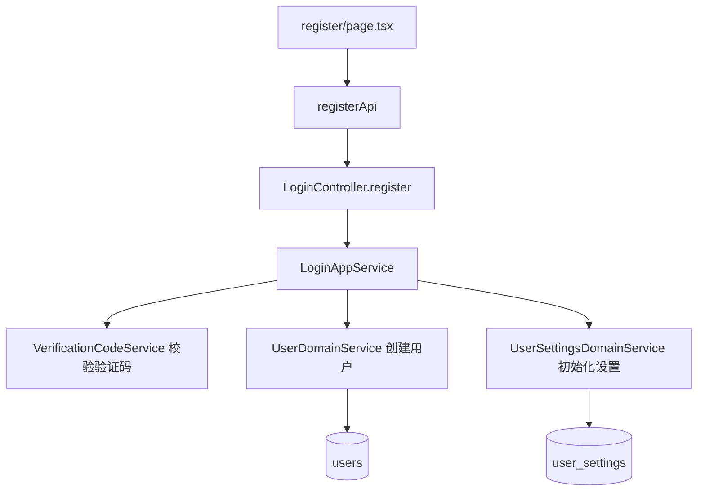

普通登录链路：

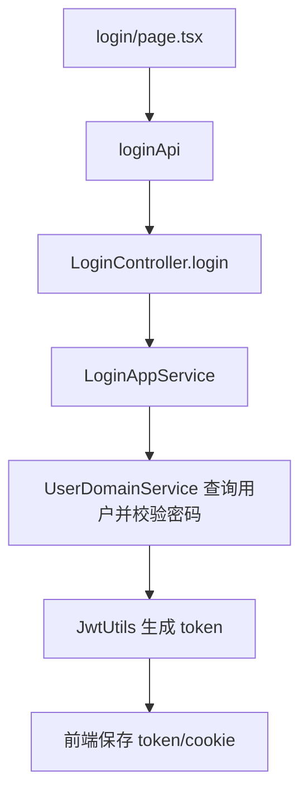

请求鉴权链路：

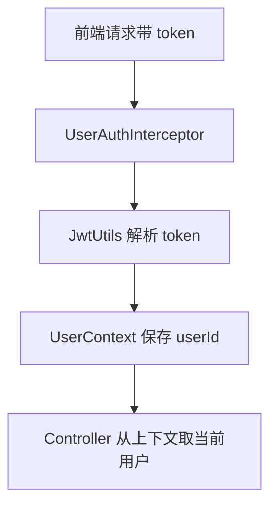

### 5.4 关键类职责

`LoginAppService`：登录、注册、验证码、重置密码的应用编排。它会调用用户领域服务、验证码服务和邮件服务。

`UserAppService`：用户资料、密码修改等普通用户操作。

`UserSettingsAppService`：用户设置，例如默认模型、fallback 配置、OCR/Embedding 模型选择。

`AuthSettingAppService`：登录方式配置的应用层封装。

`UserDomainService`：用户创建、查询、密码校验、状态校验等领域规则。

`UserSettingsDomainService`：用户设置的读取和更新。

`AuthSettingDomainService`：`auth_settings` 的领域规则。

`EmailService`：真正发送邮件。

`VerificationCodeService`：验证码生成、保存、频控、校验。

`AdminAuthInterceptor`：管理后台接口权限拦截。

### 5.5 数据表

- `users`：用户主表。对应 `UserEntity`。
- `user_settings`：用户设置。对应 `UserSettingsEntity`，包含模型配置、fallback 等用户偏好。
- `auth_settings`：登录注册方式配置。对应 `AuthSettingEntity`。

学习时先看 Entity 字段，再去 `docs/sql/01_init.sql` 找表结构，最后回到 Controller 看接口如何暴露。

## 6. Agent 创建、编辑、发布与工作区

### 6.1 业务作用

Agent 是项目的核心业务对象。用户创建的不是一次聊天，而是一个可复用的“智能体配置”。

Agent 至少包含：

- 名称、头像、描述。
- 系统提示词。
- 可用工具列表。
- 绑定知识库列表。
- 工具预设参数。
- 是否启用。
- 发布版本。

工作区则表示“当前用户把某个 Agent 加入自己的使用空间，并配置自己的模型参数”。

### 6.2 前端入口

- `app/(main)/studio/page.tsx`：创建和管理 Agent。
- `app/(main)/workspace/page.tsx`：工作区使用 Agent。
- `components/agent-form-modal.tsx`：Agent 创建/编辑表单。
- `components/agent-sidebar.tsx`：工作区 Agent 列表。
- `components/agent-preview-chat.tsx`：预览 Agent 表现。
- `hooks/use-agent-form.ts`：表单状态。
- `hooks/use-agent-operations.ts`：创建、更新、删除、发布等操作。
- `lib/agent-service.ts`：Agent 接口封装。
- `lib/agent-api-service.ts`、`lib/agent-preview-service.ts`：Agent 相关补充接口。

### 6.3 后端入口

`PortalAgentController` 负责 Agent 主体操作：

- `POST /agents`：创建 Agent。
- `GET /agents/{agentId}`：查看 Agent。
- `GET /agents/user`：当前用户 Agent。
- `GET /agents/published`：已发布 Agent。
- `PUT /agents/{agentId}`：更新 Agent。
- `PUT /agents/{agentId}/toggle-status`：启用/禁用。
- `DELETE /agents/{agentId}`：删除。
- `POST /agents/{agentId}/publish`：发布版本。
- `GET /agents/{agentId}/versions`：版本列表。
- `POST /agents/generate-system-prompt`：生成系统提示词。

`PortalWorkspaceController` 负责工作区：

- `GET /agents/workspaces/agents`：工作区 Agent。
- `POST /agents/workspaces/{agentId}`：加入工作区。
- `DELETE /agents/workspaces/agents/{id}`：从工作区删除。
- `PUT /agents/workspaces/{agentId}/model/config`：配置工作区模型。
- `GET /agents/workspaces/{agentId}/model-config`：查询模型配置。

`AgentKnowledgeBaseController` 负责 Agent 可绑定知识库。

`AdminAgentController` 负责管理后台审核 Agent 版本和统计。

### 6.4 后端核心链路

创建 Agent：

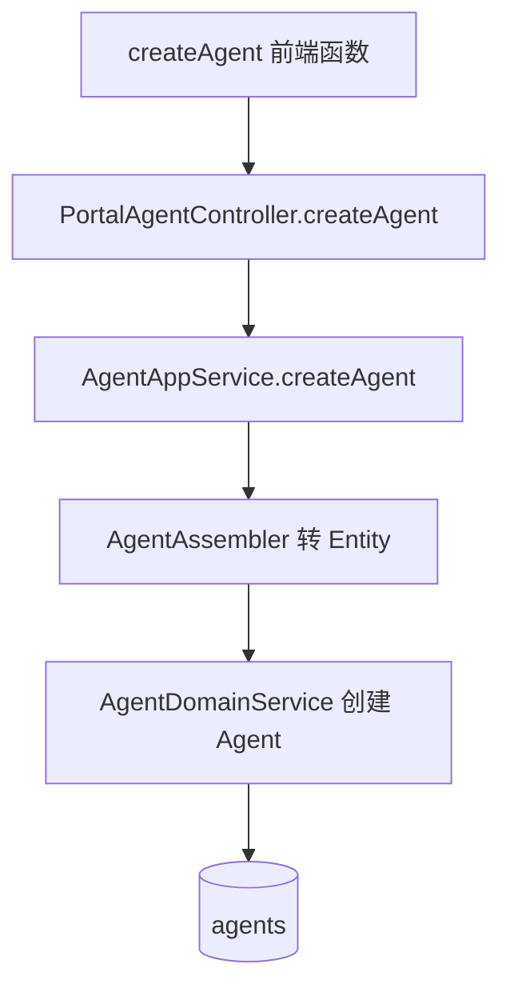

发布 Agent：

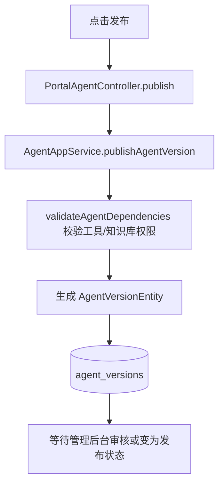

加入工作区：

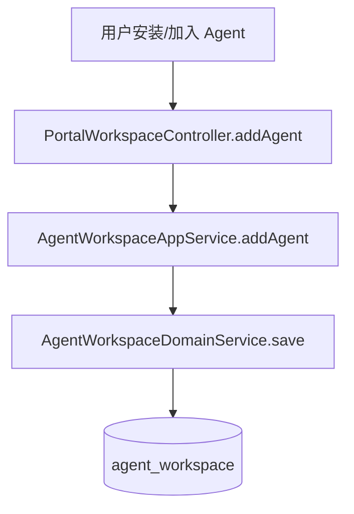

### 6.5 关键类职责

`AgentAppService` 是 Agent 主应用服务。重要方法：

- `createAgent`：创建 Agent。
- `getAgent`：查询 Agent。
- `getUserAgents`：查询用户自己的 Agent。
- `getPublishedAgentsByName`：按名称查已发布 Agent。
- `updateAgent`：更新 Agent。
- `toggleAgentStatus`：启用/禁用。
- `deleteAgent`：删除。
- `publishAgentVersion`：发布版本。
- `reviewAgentVersion`：审核版本。
- `validateAgentDependencies`：发布时校验工具和知识库权限。

`AgentWorkspaceAppService` 处理工作区。重要方法：

- `getAgents`：获取工作区 Agent。
- `deleteAgent`：从工作区移除。
- `getConfiguredModelId`：获取工作区模型配置。
- `updateModelConfig`：更新工作区模型配置。
- `addAgent`：加入工作区。

`SystemPromptGeneratorAppService` 和 `SystemPromptGeneratorDomainService` 用于根据 Agent 名称、描述、工具、知识库生成系统提示词。

`AgentEntity` 对应 `agents` 表，是 Agent 草稿/主体。

`AgentVersionEntity` 对应 `agent_versions` 表，是发布后的版本快照。

`AgentWorkspaceEntity` 对应 `agent_workspace` 表，是用户工作区里的 Agent 使用关系。

`LLMModelConfig` 是 Agent 工作区的模型配置对象。

### 6.6 学习检查点

读完本章你要能回答：

- Agent 和 AgentVersion 有什么区别？
- AgentWorkspace 为什么不能直接用 Agent 表替代？
- 发布 Agent 时为什么要校验工具和知识库权限？
- 工作区模型配置为什么放在工作区，而不是直接写死在 Agent 上？

## 7. 会话、聊天、上下文与 Agent 执行主链

### 7.1 为什么这是全项目核心

聊天链路把前面所有模块都串起来：

- 需要用户登录鉴权。
- 需要 Agent 配置。
- 需要工作区模型配置。
- 需要模型服务商和高可用选择。
- 可能需要工具。
- 可能需要知识库。
- 需要保存消息和上下文。
- 需要 SSE 流式返回。
- 需要支持中断。

你真正学会 AgentX，必须把这条链走通。

### 7.2 前端入口

重点读：

- `components/chat-panel.tsx`：聊天 UI 主体。
- `components/conversation-list.tsx`：会话列表。
- `hooks/use-interruptable-chat.ts`：中断控制。
- `lib/agent-session-service.ts`：会话 CRUD 和中断。
- `lib/session-message-service.ts`：消息列表。
- `lib/stream-service.ts`：SSE 流式请求。

前端大概流程：

```text
选择 Agent -> 查询/创建 session -> 输入消息 -> 发起 stream chat -> 接收 SSE token -> 更新消息列表 -> 结束或中断
```

### 7.3 后端入口

`PortalAgentSessionController` 是普通用户聊天的主要入口：

- `GET /agents/sessions/{sessionId}/messages`：消息列表。
- `GET /agents/sessions/{agentId}`：某 Agent 的会话列表。
- `POST /agents/sessions/{agentId}`：创建会话。
- `PUT /agents/sessions/{id}`：更新会话标题。
- `DELETE /agents/sessions/{id}`：删除会话。
- `POST /agents/sessions/chat`：发起聊天。
- `POST /agents/sessions/preview`：Agent 预览聊天。
- `POST /agents/sessions/{sessionId}/interrupt`：中断会话。

外部 API 入口是 `OpenController`：

- `POST /v1/chat/completions`：OpenAI 风格聊天补全。
- `GET /v1/models`：模型列表。
- `GET /v1/sessions`、`POST /v1/sessions`、`DELETE /v1/sessions/{id}`：外部会话接口。

### 7.4 ConversationAppService 主流程

`ConversationAppService.chat` 是聊天应用层入口。它做五件事：

1. `prepareEnvironmentByRequestType`：根据普通聊天、RAG 聊天等请求类型准备上下文。
2. `transportFactory.getTransport`：创建 SSE 传输。
3. `messageHandlerFactory.getHandler`：选择消息处理器。
4. `handler.chat`：交给 `AbstractMessageHandler` 模板方法执行。
5. `chatSessionManager.registerSession`：注册会话，支持中断。

普通 Agent 聊天环境准备大致是：

```text
sessionId -> SessionDomainService 查会话 -> 得到 agentId
agentId -> AgentDomainService 查 Agent 并校验
Agent.toolIds -> UserToolDomainService 查用户安装工具 -> 得到 mcpServerNames
AgentWorkspace -> 得到 LLMModelConfig
ModelEntity -> 高可用选择 Provider/Model/instanceId
ContextDomainService -> 得到上下文
ConversationDomainService -> 得到历史消息
TokenDomainService -> 处理上下文长度
ChatContext -> 交给 MessageHandler
```

### 7.5 MessageHandlerFactory

`MessageHandlerFactory` 决定用哪个消息处理器。

你可以把它理解成“聊天模式路由器”：

- 普通聊天走 `ChatMessageHandler`。
- Agent 聊天走 `AgentMessageHandler`。
- RAG 聊天走 `RagMessageHandler`。
- 预览聊天走 `PreviewMessageHandler`。

这个设计让 Controller 不需要知道具体聊天模式细节。

### 7.6 AbstractMessageHandler 模板方法

`AbstractMessageHandler.chat` 是一套模板流程：

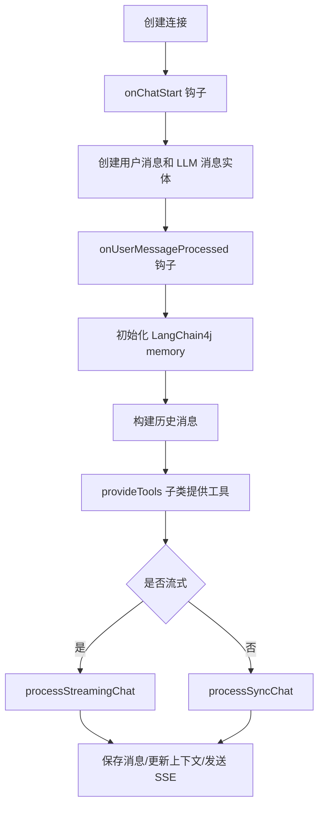

这里用到了 LangChain4j：

- `MessageWindowChatMemory`：聊天记忆窗口。
- `StreamingChatModel`：流式模型。
- `ChatModel`：同步模型。
- `AiServices`：把模型、memory、工具组装成可调用的 Agent 接口。
- `ToolProvider`：给模型提供可调用工具。
- `TokenStream`：接收流式 token、工具调用和结束事件。

`AbstractMessageHandler` 的价值在于：普通聊天、Agent 聊天、RAG 聊天共享“保存消息、构建历史、调用模型、返回 SSE、上报高可用结果”的主流程，差异点交给子类。

### 7.7 AgentMessageHandler

`AgentMessageHandler` 继承 `AbstractMessageHandler`，主要重写 `provideTools`。

它会调用：

```text
AgentToolManager.getAvailableTools(chatContext)
AgentToolManager.createToolProvider(...)
```

也就是说，Agent 聊天和普通聊天最大的区别是：Agent 聊天会把用户安装并绑定到 Agent 的工具暴露给模型。

### 7.8 AgentToolManager

`AgentToolManager` 负责把工具运行配置转成 LangChain4j 能理解的 `ToolProvider`。

它支持两类运行时：

- `REMOTE_MCP_SSE`：远程 MCP SSE 工具。
- `HTTP_API`：HTTP API 工具。

核心流程：

```text
mcpServerName -> DirectToolRuntimeResolver.resolve -> DirectToolRuntime
如果是 HTTP_API -> HttpApiToolProviderFactory.createTools
如果是 REMOTE_MCP_SSE -> RemoteMcpToolProviderFactory.createClient
把工具包装成 ToolProvider
工具执行失败时返回模型可见的失败文本
```

特别注意：工具失败不是直接吞掉。`wrapToolExecutors` 会把异常转成一段文本告诉模型：“工具执行失败，请不要继续重复调用同一个失败工具”。这让模型有机会向用户解释失败并给出下一步。

### 7.9 上下文与 Token

聊天不是每次只发当前问题。后端会从 `messages` 和 `context` 里拿历史消息，构建上下文。

相关类：

- `ContextEntity`：当前会话活跃上下文。
- `MessageEntity`：消息记录。
- `ContextDomainService`：上下文读写。
- `MessageDomainService`：消息保存更新。
- `TokenDomainService`：计算 token 并处理溢出。
- `TokenOverflowStrategyEnum`：上下文超长策略。
- `SlidingWindowTokenOverflowStrategy`：滑动窗口。
- `SummarizeTokenOverflowStrategy`：摘要策略。
- `NoTokenOverflowStrategy`：不处理。

你要理解：`messages` 是完整消息历史，`context.activeMessages` 是当前参与上下文的消息 ID 列表。这样系统可以保留历史，又控制每次发给模型的内容长度。

### 7.10 SSE 返回与中断

SSE 是服务端持续向浏览器推消息的机制。聊天时模型一点点生成内容，后端一点点推给前端。

相关类：

- `SseMessageTransport`：SSE 消息传输实现。
- `SyncMessageTransport`：同步返回实现。
- `MessageTransportFactory`：选择传输方式。
- `SseEmitterUtils`：SSE 工具。
- `ChatSessionManager`：记录活跃会话和中断状态。

中断流程：

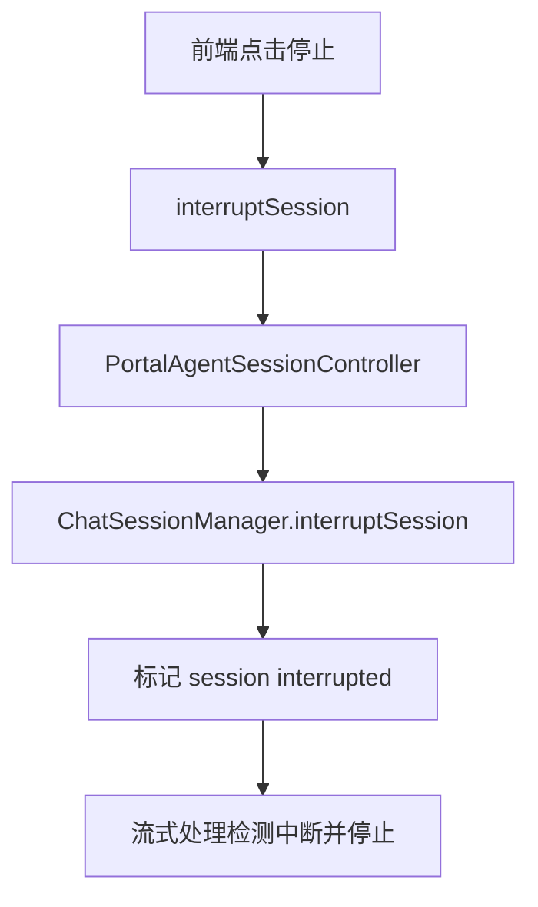

### 7.11 数据表

- `sessions`：会话。对应 `SessionEntity`。
- `messages`：消息。对应 `MessageEntity`。
- `context`：上下文。对应 `ContextEntity`。
- `agent_tasks`：Agent 任务拆分/执行相关任务。对应 `TaskEntity`。

状态和类型：

- `Role`：用户、助手、系统等角色。
- `MessageType`：文本、文件等消息类型。
- `TaskStatus`：Agent 任务状态。

### 7.12 学习检查点

读完本章你要能不看代码复述：

```text
PortalAgentSessionController.chat
-> ConversationAppService.chat
-> prepareEnvironmentByRequestType
-> MessageHandlerFactory.getHandler
-> AbstractMessageHandler.chat
-> AgentMessageHandler.provideTools
-> LLMServiceFactory
-> TokenStream/SSE
-> MessageDomainService 保存消息
-> ContextDomainService 更新上下文
```

这是 AgentX 后端最重要的一条链。

## 8. 模型服务商、模型配置与高可用

### 8.1 业务作用

模型模块解决“用哪个模型、怎么调用模型、模型失败后怎么办”的问题。

用户可能配置多个服务商和多个模型。聊天时，Agent 工作区绑定某个模型配置，但后端还会结合高可用策略选择实际 provider/model/instance。

### 8.2 前端入口

- `components/model-selector.tsx`：选择模型。
- `components/model-dialog.tsx`：模型配置弹窗。
- `components/provider-dialog.tsx`：服务商配置弹窗。
- `components/settings/fallback-config.tsx`：fallback 配置。
- `lib/api-services.ts`：模型和服务商通用接口。
- `lib/admin-provider-service.ts`：管理后台模型和服务商接口。
- `lib/admin-provider-service.ts` 中还有 `getProtocolText`、`getModelTypeText`、`getProtocolConfig`，用于前端展示协议、模型类型和配置项。

### 8.3 后端入口

`PortalLLMController`：

- `/llms/providers`：普通用户服务商管理。
- `/llms/models`：普通用户模型管理。
- `/llms/models/default`：默认模型。
- `/llms/providers/protocols`：支持的协议。
- `/llms/models/types`：模型类型。

`AdminLLMController`：

- `/admin/llms/providers`：管理员服务商管理。
- `/admin/llms/models`：管理员模型管理。

### 8.4 核心类

`LLMAppService`：普通用户模型/服务商应用服务。

`AdminLLMAppService`：管理后台模型/服务商应用服务。

`LLMDomainService`：Provider 和 Model 的领域操作。

`LLMRequestService`：模型请求相关领域服务。

`HighAvailabilityDomainService`：高可用选择服务，聊天前根据模型、用户、会话、fallback 链选择实际 provider/model/instance。

`HighAvailabilityEventListener`：监听模型变更事件，同步高可用网关。

`LLMServiceFactory`：根据 Provider/Model 创建 LangChain4j 客户端。

`HighAvailabilityGatewayClient` 和 `HighAvailabilityGatewayImpl`：对接高可用网关。

`HighAvailabilityInitializer`：初始化高可用相关数据。

### 8.5 数据模型

- `providers`：服务商。对应 `ProviderEntity`。
- `models`：模型。对应 `ModelEntity`。
- `ProviderConfig`：服务商配置。
- `ProviderProtocol`：协议类型。
- `ModelType`：模型类型，例如聊天、Embedding、Rerank、OCR 等。
- `ProviderType`：服务商类型。
- `UserSettingsConfig` / `FallbackConfig`：用户 fallback 配置。

### 8.6 聊天时模型如何被选中

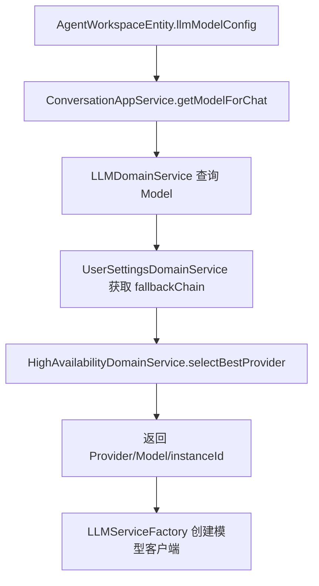

你要分清：

- Agent 配置的是“期望模型”。
- 高可用选择后得到的是“本次实际调用的 provider/model/instance”。
- 调用完成后会向高可用服务上报成功/失败和延迟。

## 9. 工具市场、MCP 与 HTTP API 工具

### 9.1 业务作用

工具模块让 Agent 不只会“说话”，还能调用外部能力。比如搜索、天气、数据库、HTTP 接口、MCP 服务等。

当前项目里工具运行已经偏向“直连运行时”：

- 远程 MCP SSE 工具：后端通过 SSE MCP client 连接远程工具。
- HTTP API 工具：后端根据工具 schema 构造 HTTP 调用。

### 9.2 前端入口

- `app/(main)/tools/page.tsx`：用户工具页面。
- `app/(main)/tools-market/page.tsx`：工具市场。
- `components/tool/install-tool-dialog.tsx`、`install-tool-dialog-new.tsx`：安装工具。
- `lib/tool-service.ts`：工具接口封装。
- `types/tool.ts`：工具类型。

`tool-service.ts` 的函数很多，你先按业务分组：

- 市场查询：`getMarketTools`、`getMarketToolDetail`、`getMarketToolVersions`。
- 安装卸载：`installTool`、`uninstallTool`、`getInstalledTools`。
- 用户自建工具：`uploadTool`、`updateTool`、`deleteTool`、`getToolDetail`。
- 发布审核：`publishToolToMarket`、`updateToolVersionStatus`。
- 推荐：`getRecommendTools`。

### 9.3 后端入口

`PortalToolController`：

- `POST /tools`：创建工具。
- `POST /tools/runtime/probe`：探测工具运行端点。
- `GET /tools/{toolId}`：工具详情。
- `GET /tools/user`：用户工具。
- `PUT /tools/{toolId}`：更新工具。
- `DELETE /tools/{toolId}`：删除工具。
- `POST /tools/market`：发布到市场。
- `GET /tools/market`：工具市场。
- `POST /tools/install/{toolId}/{version}`：安装。
- `POST /tools/uninstall/{toolId}`：卸载。
- `GET /tools/installed`：已安装工具。
- `PUT /tools/installed/{userToolId}/credential`：用户工具凭证。

`AdminToolController`：

- `/admin/tools`：管理后台工具列表、统计、官方工具、审核、全局状态。

### 9.4 核心类

`ToolAppService`：工具创建、更新、删除、市场、安装、凭证等应用层编排。

`AdminToolAppService`：管理后台工具审核和统计。

`ToolEndpointProbeService`：工具端点探测入口。

`RemoteMcpProbeClient`：探测远程 MCP SSE 工具。

`HttpApiProbeClient`：探测 HTTP API 工具。

`ToolSchemaUtils`：工具 schema 处理。

`ToolDomainService`：工具主表领域规则。

`ToolVersionDomainService`：工具版本规则。

`UserToolDomainService`：用户安装工具关系。

`ToolRuntimeConfigDomainService`：工具运行配置，当前表是 `tool_runtime_configs`。

`UserToolCredentialDomainService`：用户工具凭证，当前表是 `user_tool_credentials`。

### 9.5 数据表

- `tools`：工具主表。对应 `ToolEntity`。
- `tool_versions`：工具版本。对应 `ToolVersionEntity`。
- `user_tools`：用户安装工具。对应 `UserToolEntity`。
- `tool_runtime_configs`：运行配置。对应 `ToolRuntimeConfigEntity`。
- `user_tool_credentials`：用户工具凭证。对应 `UserToolCredentialEntity`。

核心枚举：

- `ToolType`：工具类型。
- `ToolRuntimeType`：运行类型，重点看 `REMOTE_MCP_SSE` 和 `HTTP_API`。
- `ToolStatus`：审核、发布、失败等状态。
- `ToolAuthType`：认证类型。
- `UploadType`：上传/创建类型。

### 9.6 Agent 调工具流程

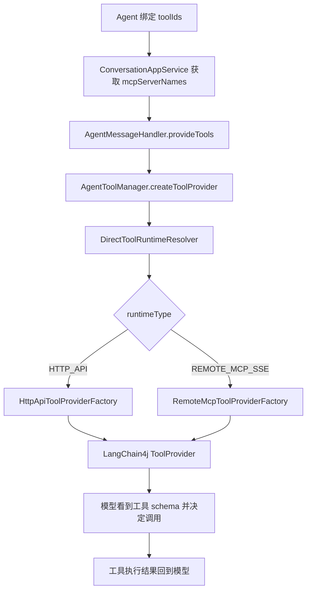

你要记住：工具不是 Controller 直接调用的，而是在模型生成过程中由 LangChain4j 的 tool calling 机制触发。

## 10. 知识库、RAG 与异步文件处理

### 10.1 业务作用

RAG 让 Agent 或用户问答时能引用知识库内容。它分为两个阶段：

1. 离线阶段：上传文件、解析、切分、向量化、入库。
2. 在线阶段：根据问题检索相关片段，把片段放进上下文，再调用模型回答。

你不能把“上传知识库”和“知识库问答”混成一个功能。它们走不同链路。

### 10.2 前端入口

- `app/(main)/knowledge/page.tsx`：知识库主页面。
- `components/knowledge/CreateDatasetDialog.tsx`：创建数据集。
- `components/knowledge/DatasetCard.tsx`：数据集卡片。
- `components/knowledge/FileStatusBadge.tsx`：文件处理状态。
- `components/knowledge/DocumentUnitsDialog.tsx`：文档片段。
- `components/rag-chat/*`：知识库聊天。
- `lib/rag-dataset-service.ts`：数据集和文件处理。
- `lib/rag-file-service.ts`：文件详情、文档片段。
- `lib/rag-chat-service.ts`：RAG 流式聊天。
- `lib/rag-publish-service.ts`：知识库发布、安装、审核。
- `hooks/rag-chat/*`：RAG 聊天状态。

### 10.3 后端入口

`RagQaDatasetController`：

- `POST /rag/datasets`：创建知识库。
- `PUT /rag/datasets/{datasetId}`：更新。
- `DELETE /rag/datasets/{datasetId}`：删除。
- `GET /rag/datasets/{datasetId}`：详情。
- `GET /rag/datasets`：分页列表。
- `POST /rag/datasets/files`：上传/绑定文件。
- `POST /rag/datasets/files/process`：处理文件。
- `POST /rag/datasets/files/reprocess`：重新处理。
- `GET /rag/datasets/files/{fileId}/progress`：文件进度。

`FileOperationController`：

- 文件详情。
- 文档片段列表。
- 更新/删除文档片段。

`RagSearchController`：

- `POST /rag/search`：检索。
- `POST /rag/search/stream-chat`：RAG 流式问答。
- `POST /rag/search/user-rag/{userRagId}`：基于已安装知识库检索。
- `POST /rag/search/user-rag/{userRagId}/stream-chat`：基于已安装知识库问答。

`RagMarketController` 和 `RagPublishController`：知识库市场、发布、安装、版本。

`AdminRagReviewController`：知识库审核。

### 10.4 离线处理链路

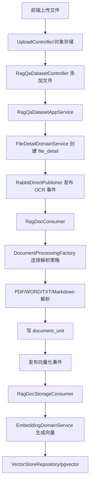

关键点：

- `file_detail` 是文件处理状态中心。
- `document_unit` 是最终可检索片段。
- OCR/解析和向量化是两个阶段。
- RabbitMQ 把耗时处理从 HTTP 请求里拆出去。

### 10.5 在线检索链路

`RAGSearchAppService.ragSearch` 负责在线检索。它会：

1. 校验用户是否有知识库权限。
2. 获取用户 Embedding 模型配置。
3. 获取用户聊天模型配置，用于 HyDE。
4. 构造 `HybridSearchConfig`。
5. 调用 `HybridSearchDomainService.hybridSearch`。
6. 把 `DocumentUnitEntity` 转成 DTO 返回。

`HybridSearchDomainService` 做混合检索：

```text
问题 -> HyDE 生成假设文档 -> 并行向量检索 + 关键词检索 -> RRF 融合 -> 可选 rerank -> 可选查询扩展 -> DocumentUnit
```

RRF 参数 `RRF_K = 60`。你只要理解公式作用：把不同检索方式的排名融合到一个排序里，避免只依赖向量或只依赖关键词。

### 10.6 RAG 如何进入聊天

RAG 有两种使用方式：

第一，用户直接在知识库里问答。入口是 `RagSearchController`，后端会走 `ConversationAppService.ragStreamChat` 或 `ragStreamChatByUserRag`。

第二，Agent 绑定知识库后，在 Agent 聊天中通过内置知识库工具检索。相关类：

- `BuiltInToolRegistry`
- `BuiltInToolProvider`
- `RagBuiltInToolProvider`
- `RagMessageHandler`

你可以理解成：RAG 检索结果不是最终答案，它是“给模型看的参考材料”。最终回答仍然由聊天模型生成。

### 10.7 核心类职责

`RagQaDatasetAppService`：知识库数据集创建、更新、删除、文件绑定、处理入口。

`FileOperationAppService`：文件详情、文档片段查看和编辑。

`RagMarketAppService`：知识库市场。

`RagPublishAppService`：知识库发布、版本、审核。

`RAGSearchAppService`：在线检索和 RAG 问答。

`RagDocConsumer`：OCR/解析消费者。

`RagDocStorageConsumer`：向量化消费者。

`DocumentProcessingFactory`：根据文件类型选择解析策略。

`WORDDocumentProcessing`、`PDFRagDocDocumentProcessing`、`TXTRagDocDocumentProcessing`、`MarkdownRagDocumentProcessing`：不同文件类型处理策略。

`EmbeddingDomainService`：Embedding 和向量检索。

`KeywordSearchDomainService`：关键词检索。

`HybridSearchDomainService`：混合检索。

`HyDEDomainService`：生成假设文档。

`RerankDomainService`：重排。

### 10.8 数据表

- `ai_rag_qa_dataset`：知识库数据集。对应 `RagQaDatasetEntity`。
- `file_detail`：文件处理详情和进度。对应 `FileDetailEntity`。
- `document_unit`：文档片段。对应 `DocumentUnitEntity`。
- `rag_versions`：知识库发布版本。对应 `RagVersionEntity`。
- `rag_version_files`：版本文件。对应 `RagVersionFileEntity`。
- `rag_version_documents`：版本文档片段。对应 `RagVersionDocumentEntity`。
- `user_rags`：用户安装知识库。对应 `UserRagEntity`。
- `user_rag_files`：用户安装知识库文件快照/引用。对应 `UserRagFileEntity`。
- `user_rag_documents`：用户安装知识库文档快照。对应 `UserRagDocumentEntity`。

状态枚举：

- `FileProcessingStatusEnum`：上传、OCR 处理中、OCR 完成、Embedding 处理中、完成、失败等。
- `FileProcessingEventEnum`：状态转换事件。
- `EmbeddingStatusEnum`：Embedding 状态。
- `RagPublishStatus`：知识库发布审核状态。
- `InstallType`：REFERENCE / SNAPSHOT 安装方式。
- `SearchType`：搜索类型。

## 11. 定时任务

### 11.1 业务作用

定时任务让 Agent 在未来某个时间或按重复规则自动执行。它本质上是“把一次 Agent 会话触发从用户手动点击变成系统按时间触发”。

### 11.2 前端入口

- `components/scheduled-task-panel.tsx`
- `components/scheduled-task-list.tsx`
- `components/scheduled-task-dialog.tsx`
- `lib/scheduled-task-service.ts`

`scheduled-task-service.ts` 里不只有接口函数，还有前后端重复类型、时间单位、星期几映射函数。你读它时要关注“前端表单值如何变成后端 RepeatConfig”。

### 11.3 后端入口和核心类

`PortalScheduledTaskController`：

- `POST /scheduled-tasks`：创建。
- `PUT /scheduled-tasks/{taskId}`：更新。
- `DELETE /scheduled-tasks/{taskId}`：删除。
- `GET /scheduled-tasks`：列表。
- `GET /scheduled-tasks/agent/{agentId}`：某 Agent 的任务。
- `POST /scheduled-tasks/{taskId}/pause`：暂停。
- `POST /scheduled-tasks/{taskId}/resume`：恢复。

核心类：

- `ScheduledTaskAppService`：应用层编排。
- `ScheduledTaskDomainService`：任务领域规则。
- `TaskScheduleService`：调度服务。
- `ScheduledTaskExecutionService`：执行服务。
- `DelayedTaskQueueManager`：延迟队列管理。
- `ScheduleTaskExecutor`：实际执行。
- `ScheduledTaskExecuteEvent`：执行事件。
- `ScheduledTaskEntity`：对应 `scheduled_tasks` 表。
- `RepeatConfig`：重复规则。
- `DelayedTaskItem`：延迟队列元素。
- `RepeatType`：重复类型。
- `ScheduleTaskStatus`：状态。

### 11.4 执行链路

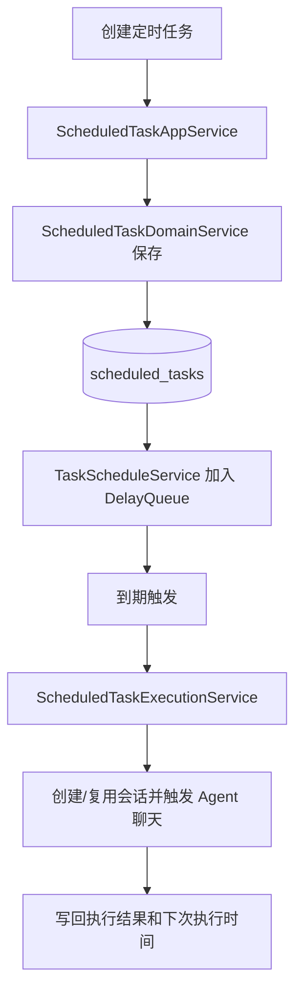

学习时重点理解：定时任务模块自己不生成 AI 内容，它只是按时间把任务交给 Agent 会话链执行。

## 12. API Key 与开放接口

### 12.1 业务作用

API Key 模块让外部系统调用用户的 Agent。用户创建 API Key 后，外部请求可以通过 `/v1/chat/completions` 走类似 OpenAI 的接口。

### 12.2 前端入口

- `components/api-keys/api-key-list.tsx`
- `components/api-keys/create-api-key-dialog.tsx`
- `components/api-keys/delete-api-key-dialog.tsx`
- `components/api-keys/api-key-filters.tsx`
- `components/api-keys/api-usage-guide.tsx`
- `lib/api-key-service.ts`
- `types/api-key.ts`

### 12.3 后端入口

`PortalApiKeyController`：

- `POST /api-keys`：创建。
- `GET /api-keys`：当前用户 API Key。
- `GET /api-keys/agent/{agentId}`：某 Agent API Key。
- `GET /api-keys/{apiKeyId}`：详情。
- `PUT /api-keys/{apiKeyId}/status`：启停。
- `DELETE /api-keys/{apiKeyId}`：删除。
- `POST /api-keys/{apiKeyId}/reset`：重置。

`OpenController`：

- `/v1/chat/completions`
- `/v1/models`
- `/v1/sessions`

### 12.4 核心类和链路

`ApiKeyAppService`：API Key 应用服务。

`ApiKeyDomainService`：API Key 创建、校验、状态、归属。

`ApiKeyEntity`：对应 `api_keys` 表。

`ExternalApiKeyInterceptor`：外部 API Key 拦截器。

`ExternalApiContext`：外部调用上下文。

外部调用链：

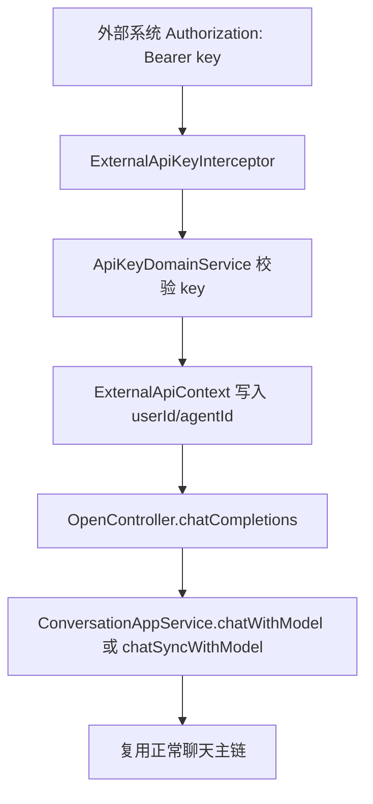

## 13. 管理后台

### 13.1 业务作用

管理后台不是普通用户功能，而是治理入口：

- 用户管理。
- Agent 版本审核。
- 工具审核。
- 知识库审核。
- 模型和服务商配置。
- 登录方式配置。

### 13.2 前端入口

- `app/(main)/admin/page.tsx`
- `components/admin/AgentDetailsDialog.tsx`
- `components/admin/AgentVersionsDialog.tsx`
- `components/admin/ToolDetailsDialog.tsx`
- `components/admin/ToolReviewDialog.tsx`
- `components/admin/rag/RagDetailsDialog.tsx`
- `components/admin/rag/RagReviewDialog.tsx`
- `lib/admin-agent-service.ts`
- `lib/admin-tool-service.ts`
- `lib/admin-rag-service.ts`
- `lib/admin-provider-service.ts`
- `lib/admin-user-service.ts`

### 13.3 后端入口

- `AdminUserController`：用户列表。
- `AdminAgentController`：Agent 列表、统计、版本审核。
- `AdminToolController`：工具列表、统计、审核、官方工具、全局状态。
- `AdminRagReviewController`：知识库审核、预览、统计。
- `AdminLLMController`：Provider/Model 管理。
- `AdminAuthSettingController`：登录方式管理。

管理后台接口统一在 `/admin/*` 下，通常会经过管理员权限拦截。读这些 Controller 时重点看“它治理哪个普通用户模块”。

## 14. 文件上传与对象存储

### 14.1 业务作用

文件上传模块为头像、普通聊天附件、知识库文件提供统一上传能力。它本身不是 RAG，但 RAG 文件处理以它为前置。

### 14.2 前端入口

- `components/multi-modal-upload.tsx`：多文件/多模态上传。
- `lib/file-upload-service.ts`：上传凭证、上传到 OSS、批量上传、单文件上传。
- `lib/file-status-utils.ts`：文件状态展示。

### 14.3 后端入口和核心类

`UploadController`：

- `GET /upload/credential`：获取上传凭证。

核心类：

- `FileStorageAppService`：应用层入口。
- `FileStorageStrategyFactory`：按文件业务类型选择策略。
- `FileStorageStrategy`：策略接口。
- `AvatarFileStorageStrategy`：头像。
- `GeneralFileStorageStrategy`：普通文件。
- `RagFileStorageStrategy`：知识库文件。
- `FileStorageConfig`：文件存储配置。
- `OssUploadService`：对象存储上传基础设施。
- `FileInfo`：文件信息对象。
- `FileTypeEnum`：文件类型。

### 14.4 上传和 RAG 的关系

```text
上传模块负责把文件放到对象存储并提供文件信息。
RAG 模块负责把已上传文件变成可检索的 document_unit。
```

不要把这两件事混淆。上传成功不代表 OCR 成功，更不代表向量化成功。

## 15. 数据库学习

### 15.1 先按业务域记表

用户认证：

- `users`
- `user_settings`
- `auth_settings`

Agent：

- `agents`
- `agent_versions`
- `agent_workspace`

会话聊天：

- `sessions`
- `messages`
- `context`
- `agent_tasks`

模型：

- `providers`
- `models`

工具：

- `tools`
- `tool_versions`
- `user_tools`
- `tool_runtime_configs`
- `user_tool_credentials`

RAG：

- `ai_rag_qa_dataset`
- `file_detail`
- `document_unit`
- `rag_versions`
- `rag_version_files`
- `rag_version_documents`
- `user_rags`
- `user_rag_files`
- `user_rag_documents`

定时任务：

- `scheduled_tasks`

开放接口：

- `api_keys`

### 15.2 读表的方法

每张表按这个顺序读：

1. 表名对应哪个 Entity。
2. `id`、`user_id`、`agent_id`、`session_id` 这类归属字段。
3. 状态字段，例如 `status`、`enabled`、`publish_status`、`processing_status`。
4. JSON 字段，对应哪个 config/model 类。
5. 创建时间、更新时间、软删除字段。
6. 哪个 Controller/AppService 会写它。
7. 哪个查询场景会读它。

例如 `file_detail`：

```text
Entity：FileDetailEntity
业务：记录上传文件和处理进度
关键状态：processing_status、ocr_process_progress、embedding_process_progress
写入：RAG 文件添加/处理
更新：RagDocConsumer、RagDocStorageConsumer
读取：前端文件进度、文件详情、RAG 处理排查
```

## 16. 消息队列与事件

### 16.1 MQ 在项目里的角色

MQ 的本质是把“现在不适合在 HTTP 请求里直接做的事情”拆出去异步做。

当前最重要的是 RAG：

- `RagDocSyncOcrEvent`
- `RagDocSyncStorageEvent`
- `RagDocConsumer`
- `RagDocStorageConsumer`

### 16.2 关键类

`EventType`：事件类型枚举。

`MessageEnvelope`：消息信封。

`MessageHeaders`：消息头。

`MessagePublisher`：发布接口。

`MessageRoute`：路由定义。

`RabbitDirectConfig`：RabbitMQ direct exchange 配置。

`RabbitMessageConfig`：消息配置。

`RabbitDirectPublisher`：具体 RabbitMQ 发布实现。

学习 MQ 时，把“发布事件”和“消费事件”分开看。发布方只说明“我要处理一个文件”，消费方才是真正解析和向量化的地方。

## 17. 异常、返回值与通用工程能力

### 17.1 统一返回

`Result` 是后端统一响应包装。Controller 通常返回 `Result<T>`，前端 `ApiResponse<T>` 与它对应。

`Page` 和 `PageResult` 用于分页。

### 17.2 统一异常

重点异常：

- `BusinessException`：业务异常。
- `ParamValidationException`：参数校验异常。
- `EntityNotFoundException`：实体不存在。
- `RateLimitException`：限流异常。

`GlobalExceptionHandler` 负责把异常转成统一响应。读业务代码时，如果看到 `throw new BusinessException`，要理解这是主动给前端的业务错误，不是系统崩溃。

### 17.3 配置、转换和工具

`converter` 目录里有很多 JSON/枚举转换器，用于数据库字段和 Java 对象之间转换。

`JsonTypeHandler` 处理 MyBatis JSON 类型。

`JwtUtils` 处理 token。

`PasswordUtils` 处理密码。

`ValidationUtils` 处理参数校验。

`JsonUtils` 处理 JSON 序列化。

`ConfigEncryptor` 处理配置加密。

这些不是业务主线，但读 Entity 字段和数据库 JSON 列时经常会遇到。

## 18. 逐文件学习索引

### 18.1 第一优先级：聊天主链

先读这些文件。读完它们，你就抓住了项目主干。

| 文件 | 层级 | 作用 |
|---|---|---|
| `interfaces/api/portal/agent/PortalAgentSessionController.java` | Controller | 会话、聊天、预览、中断入口 |
| `application/conversation/service/ConversationAppService.java` | AppService | 聊天环境准备、处理器选择、SSE 注册 |
| `application/conversation/service/handler/MessageHandlerFactory.java` | Factory | 根据请求/Agent 选择消息处理器 |
| `application/conversation/service/message/AbstractMessageHandler.java` | Template | 聊天模板方法、模型调用、消息保存、SSE 返回 |
| `application/conversation/service/message/chat/ChatMessageHandler.java` | Handler | 普通聊天处理器 |
| `application/conversation/service/message/agent/AgentMessageHandler.java` | Handler | Agent 聊天处理器，提供工具 |
| `application/conversation/service/message/RagMessageHandler.java` | Handler | RAG 聊天处理器 |
| `application/conversation/service/message/preview/PreviewMessageHandler.java` | Handler | Agent 预览聊天 |
| `application/conversation/service/message/agent/AgentToolManager.java` | Tool | Agent 工具组装 |
| `domain/conversation/service/SessionDomainService.java` | Domain | 会话领域服务 |
| `domain/conversation/service/MessageDomainService.java` | Domain | 消息领域服务 |
| `domain/conversation/service/ContextDomainService.java` | Domain | 上下文领域服务 |
| `domain/conversation/service/impl/ChatCompletionHandlerImpl.java` | Domain/LLM | 聊天补全处理 |
| `infrastructure/transport/SseMessageTransport.java` | Infrastructure | SSE 返回 |
| `application/conversation/service/ChatSessionManager.java` | AppService | 会话中断管理 |

### 18.2 第二优先级：Agent

| 文件 | 作用 |
|---|---|
| `PortalAgentController.java` | Agent CRUD、发布、版本 |
| `PortalWorkspaceController.java` | 工作区 Agent 和模型配置 |
| `AgentKnowledgeBaseController.java` | Agent 可绑定知识库 |
| `AgentAppService.java` | Agent 创建、更新、发布、审核、依赖校验 |
| `AgentWorkspaceAppService.java` | 工作区 Agent 管理 |
| `AgentSessionAppService.java` | Agent 会话应用服务 |
| `SystemPromptGeneratorAppService.java` | 生成系统提示词 |
| `AgentEntity.java` | Agent 主体 |
| `AgentVersionEntity.java` | Agent 版本 |
| `AgentWorkspaceEntity.java` | 用户工作区 Agent |
| `LLMModelConfig.java` | Agent 模型配置 |
| `AgentDomainService.java` | Agent 领域规则 |
| `AgentWorkspaceDomainService.java` | 工作区领域规则 |
| `SystemPromptGeneratorDomainService.java` | 系统提示词生成领域逻辑 |
| `AgentValidator.java` | Agent/Session 校验 |

### 18.3 第三优先级：工具/MCP

| 文件 | 作用 |
|---|---|
| `PortalToolController.java` | 工具用户接口 |
| `AdminToolController.java` | 工具管理接口 |
| `ToolAppService.java` | 工具应用服务 |
| `ToolEndpointProbeService.java` | 工具端点探测 |
| `RemoteMcpProbeClient.java` | 远程 MCP 探测 |
| `HttpApiProbeClient.java` | HTTP API 工具探测 |
| `DirectToolRuntime.java` | 会话执行期工具运行配置 |
| `DirectToolRuntimeResolver.java` | 根据 serverName/userId 解析运行时 |
| `RemoteMcpToolProviderFactory.java` | 创建远程 MCP 工具 Provider |
| `HttpApiToolProviderFactory.java` | 创建 HTTP API 工具 Provider |
| `ToolAuthSupport.java` | 工具认证支持 |
| `ToolEntity.java` | 工具主表实体 |
| `ToolVersionEntity.java` | 工具版本实体 |
| `ToolRuntimeConfigEntity.java` | 工具运行配置 |
| `UserToolEntity.java` | 用户安装工具 |
| `UserToolCredentialEntity.java` | 用户工具凭证 |

### 18.4 第四优先级：RAG

| 文件 | 作用 |
|---|---|
| `RagQaDatasetController.java` | 知识库和文件处理入口 |
| `FileOperationController.java` | 文件和文档片段操作 |
| `RagSearchController.java` | RAG 检索和问答 |
| `RagMarketController.java` | 知识库市场 |
| `RagPublishController.java` | 知识库发布 |
| `AdminRagReviewController.java` | 知识库审核 |
| `RagQaDatasetAppService.java` | 知识库应用服务 |
| `FileOperationAppService.java` | 文件操作应用服务 |
| `RAGSearchAppService.java` | 检索和问答应用服务 |
| `HybridSearchDomainService.java` | 混合检索 |
| `EmbeddingDomainService.java` | Embedding 和向量检索 |
| `KeywordSearchDomainService.java` | 关键词检索 |
| `HyDEDomainService.java` | 假设文档生成 |
| `RerankDomainService.java` | 重排 |
| `RagDocConsumer.java` | OCR/解析消费者 |
| `RagDocStorageConsumer.java` | 向量化消费者 |
| `DocumentProcessingFactory.java` | 文档处理策略工厂 |
| `WORDDocumentProcessing.java` | Word 处理 |
| `PDFRagDocDocumentProcessing.java` | PDF 处理 |
| `TXTRagDocDocumentProcessing.java` | TXT 处理 |
| `MarkdownRagDocumentProcessing.java` | Markdown 处理 |

### 18.5 第五优先级：认证、模型、定时任务、API Key

| 模块 | 重点文件 |
|---|---|
| 认证用户 | `LoginController`、`PortalUserController`、`LoginAppService`、`UserAppService`、`UserDomainService`、`VerificationCodeService` |
| 模型 | `PortalLLMController`、`AdminLLMController`、`LLMAppService`、`LLMDomainService`、`LLMServiceFactory`、`HighAvailabilityDomainService` |
| 定时任务 | `PortalScheduledTaskController`、`ScheduledTaskAppService`、`ScheduledTaskDomainService`、`TaskScheduleService`、`ScheduledTaskExecutionService` |
| API Key | `PortalApiKeyController`、`OpenController`、`ApiKeyAppService`、`ApiKeyDomainService`、`ExternalApiKeyInterceptor` |
| 管理后台 | `AdminUserController`、`AdminAgentController`、`AdminToolController`、`AdminRagReviewController`、`AdminLLMController` |

### 18.6 前端逐文件索引

| 前端区域 | 先读文件 |
|---|---|
| 全局入口 | `app/layout.tsx`、`app/providers.tsx`、`app/globals.css` |
| 登录注册 | `app/(auth)/login/page.tsx`、`register/page.tsx`、`reset-password/page.tsx`、`lib/api-services.ts` |
| 工作区聊天 | `app/(main)/workspace/page.tsx`、`components/chat-panel.tsx`、`components/conversation-list.tsx`、`lib/stream-service.ts`、`hooks/use-interruptable-chat.ts` |
| Agent | `app/(main)/studio/page.tsx`、`components/agent-form-modal.tsx`、`hooks/use-agent-form.ts`、`hooks/use-agent-operations.ts`、`lib/agent-service.ts` |
| 知识库 | `app/(main)/knowledge/page.tsx`、`components/knowledge/*`、`components/rag-chat/*`、`lib/rag-dataset-service.ts`、`lib/rag-chat-service.ts` |
| 工具 | `app/(main)/tools/page.tsx`、`tools-market/page.tsx`、`components/tool/*`、`lib/tool-service.ts` |
| 管理后台 | `app/(main)/admin/page.tsx`、`components/admin/*`、`lib/admin-*service.ts` |

## 19. 从上到下的完整学习计划

### 19.1 第一天：建立项目地图

读本文第 1 到 4 章。目标不是记住每个文件，而是能画出：

```text
前端 app/components/lib/hooks/types
后端 interfaces/application/domain/infrastructure
deploy/docker/docs/sql/resources
```

完成后，你应该能回答“用户点击聊天按钮后，大概从前端到后端经过哪些目录”。

### 19.2 第二天：读聊天主链

按第 18.1 的顺序读文件。每读一个文件，只记录三件事：

1. 它是谁调用的。
2. 它调用谁。
3. 它在聊天链路中负责哪一步。

这一轮不要陷入每个字段细节。先把主链串起来。

### 19.3 第三天：读 Agent

读第 6 章和第 18.2 文件。重点理解：

- Agent、AgentVersion、AgentWorkspace 的区别。
- 发布时为什么需要版本。
- 工作区为什么保存用户自己的模型配置。
- Agent 如何绑定工具和知识库。

### 19.4 第四天：读工具/MCP

读第 9 章和第 18.3 文件。重点理解：

- 工具创建、探测、发布、安装是管理链路。
- Agent 调工具是运行链路。
- `AgentToolManager` 是连接 Agent 聊天和工具运行的关键。
- 工具失败会作为文本返回给模型，而不是静默失败。

### 19.5 第五天：读 RAG

读第 10 章和第 18.4 文件。重点理解两条链：

```text
上传文件 -> OCR/解析 -> document_unit -> embedding -> pgvector
用户提问 -> hybridSearch -> document_unit -> 模型上下文 -> 回答
```

RAG 的难点不是 Controller，而是异步状态、文件处理策略、混合检索和模型配置。

### 19.6 第六天：补齐账号、模型、定时任务、API Key

这些模块相对独立。按第 5、8、11、12 章读，重点看它们如何接入聊天主链：

- 账号提供 userId。
- 模型提供 LLM 调用能力。
- 定时任务自动触发 Agent。
- API Key 让外部系统调用 Agent。

### 19.7 第七天：前端回读

最后回到前端，不要一开始就钻 UI。

按这个顺序：

```text
page.tsx -> 业务 component -> hook -> lib service -> types -> 后端 Controller
```

比如工作区聊天：

```text
workspace/page.tsx
-> chat-panel.tsx
-> use-interruptable-chat.ts
-> stream-service.ts / agent-session-service.ts
-> PortalAgentSessionController
```

这样你就能把前端和后端接起来。

## 20. 复述清单

### 20.1 你必须能复述的 8 条链路

1. 登录注册链路。
2. 创建 Agent 链路。
3. 发布 Agent 版本链路。
4. 创建会话链路。
5. Agent 聊天链路。
6. Agent 调工具链路。
7. RAG 文件处理链路。
8. RAG 在线检索链路。

### 20.2 最小毕业答辩版表述

如果用一段话介绍后端核心：

```text
AgentX 后端采用 Controller、Application、Domain、Infrastructure 分层。Controller 负责接收前端请求，Application 负责编排用户用例，Domain 保存 Agent、会话、工具、知识库等核心业务规则，Infrastructure 对接模型服务、对象存储、消息队列、SSE、邮件和 RAG 解析能力。系统最核心的链路是会话聊天：用户在前端工作区发送消息后，后端根据 session 找到 Agent 和工作区模型配置，选择高可用模型服务商，加载历史上下文并控制 token，再通过不同 MessageHandler 处理普通聊天、Agent 工具调用或 RAG 检索，最终通过 SSE 流式返回并保存消息上下文。
```

如果用一段话介绍前端：

```text
AgentX 前端基于 Next.js 15 和 React 19，使用 App Router 组织页面，app 目录负责路由入口，components 目录负责业务组件和通用 UI，lib 目录封装后端接口，hooks 目录封装聊天、Agent 表单、RAG 会话等复用状态逻辑，types 目录定义前后端交互数据结构。前端的核心页面是 workspace、studio、knowledge、tools 和 admin，分别对应 Agent 使用、Agent 创建管理、知识库、工具市场和后台治理。
```

### 20.3 后续继续补笔记的位置

后续每次深入一个模块，就在对应章节继续补：

- 方法级源码解释补到该模块章节。
- 每个文件的职责补到第 18 章逐文件索引。
- 新画的流程图补到对应模块末尾。
- 调试经验补到对应模块的“容易误解的地方”。

不要再新建零散学习文件，除非是单独的专题方案。这个文件作为项目学习主书稿持续维护。

## 21. 全文件定位附录：后端看到文件名就知道它大概干什么

### 21.1 后端文件命名规则

后端大部分文件都可以按后缀判断职责：

- `*Controller.java`：HTTP 入口，只负责接请求和调 AppService。
- `*AppService.java`：应用用例编排，负责把多个领域服务和基础设施串起来。
- `*DomainService.java`：领域规则，负责校验、状态转换、查询规则、业务不变量。
- `*Repository.java`：数据库访问。
- `*Entity.java`：数据库表对应对象。
- `*DTO.java`：应用层或接口层数据传输对象。
- `*Request.java`：前端请求参数。
- `*Assembler.java`：Entity、DTO、Response 之间转换。
- `*Config.java` / `*Properties.java`：配置。
- `*Converter.java` / `*TypeHandler.java`：数据库 JSON/枚举字段转换。
- `*Consumer.java`：消息消费者。
- `*Event.java`：事件。
- `*Factory.java`：根据类型创建不同实现。
- `*Strategy.java`：策略接口或策略实现。
- `*Interceptor.java`：请求拦截器。

所以读文件时先不用打开内容，先看路径和后缀，基本能判断它所在位置。

### 21.2 interfaces/api：所有后端 HTTP 入口

`HealthController` 是健康检查。

`portal` 是普通用户前台：

- `LoginController`：登录、注册、验证码、找回密码。
- `PortalUserController`：当前用户信息、密码、用户设置、默认模型。
- `SsoController`：第三方登录入口和回调。
- `AuthConfigController`：前端读取登录方式配置。
- `PortalAgentController`：Agent 创建、编辑、发布、版本。
- `PortalWorkspaceController`：用户工作区 Agent 和模型配置。
- `PortalAgentSessionController`：会话、聊天、预览、中断。
- `AgentKnowledgeBaseController`：Agent 可绑定知识库。
- `TaskController`：会话相关任务查询。
- `PortalToolController`：工具创建、探测、市场、安装、凭证。
- `PortalLLMController`：服务商和模型配置。
- `UploadController`：上传凭证。
- `RagQaDatasetController`：知识库数据集、文件处理。
- `FileOperationController`：文件详情和文档片段。
- `RagSearchController`：RAG 检索和问答。
- `RagMarketController`：知识库市场和安装。
- `RagPublishController`：知识库发布和版本。
- `PortalScheduledTaskController`：定时任务。
- `PortalApiKeyController`：API Key。

`admin` 是管理后台：

- `AdminUserController`：用户管理。
- `AdminAgentController`：Agent 管理和版本审核。
- `AdminToolController`：工具管理和审核。
- `AdminRagReviewController`：知识库审核。
- `AdminLLMController`：模型和服务商管理。
- `AdminAuthSettingController`：登录方式配置管理。

`external` 是开放接口：

- `OpenController`：兼容 OpenAI 风格的外部调用入口，复用内部聊天链。

### 21.3 application：应用层按业务域定位

`application/agent`：

- `AgentAppService`：Agent 主用例。
- `AgentWorkspaceAppService`：工作区用例。
- `AgentSessionAppService`：Agent 会话用例。
- `SystemPromptGeneratorAppService`：系统提示词生成。
- `AgentAssembler`、`AgentVersionAssembler`、`AgentWorkspaceAssembler`：对象转换。
- `AgentDTO`、`AgentVersionDTO`、`AgentWorkspaceDTO`、`AgentStatisticsDTO`、`AgentWithUserDTO`：Agent 展示数据。

`application/conversation`：

- `ConversationAppService`：聊天主链的应用入口。
- `ChatSessionManager`：活跃聊天和中断。
- `RagSessionManager`：RAG 临时会话缓存。
- `MessageHandlerFactory`：选择消息处理器。
- `AbstractMessageHandler`：聊天模板方法。
- `ChatMessageHandler`：普通聊天。
- `AgentMessageHandler`：Agent 聊天。
- `RagMessageHandler`：RAG 聊天。
- `PreviewMessageHandler`：预览聊天。
- `AgentToolManager`：Agent 工具提供者组装。
- `DirectToolRuntime*`、`HttpApiToolProviderFactory`、`RemoteMcpToolProviderFactory`：工具直连运行时。
- `BuiltInToolRegistry`、`RagBuiltInToolProvider`：内置工具，尤其知识库工具。
- `AgentWorkflowContext`、`AgentWorkflowState`、`TaskSplitHandler`、`TaskExecutionHandler`、`AnalyserMessageHandler`、`SummarizeHandler`：Agent 任务执行和分析链。
- `MessageAssembler`、`SessionAssembler`：消息和会话转换。
- `ChatRequest`、`StreamChatRequest`、`ChatResponse`、`AgentChatResponse`、`MessageDTO`、`SessionDTO`：聊天 DTO。

`application/rag`：

- `RagQaDatasetAppService`：知识库数据集。
- `FileOperationAppService`：文件和片段管理。
- `RAGSearchAppService`：检索和问答。
- `RagMarketAppService`：知识库市场。
- `RagPublishAppService`：发布和版本。
- `DocumentUnitAssembler`、`FileDetailAssembler`、`RagQaDatasetAssembler`、`RagVersionAssembler`、`UserRagAssembler`：RAG 对象转换。
- `CreateDatasetRequest`、`UploadFileRequest`、`ProcessFileRequest`、`RagSearchRequest`、`RagStreamChatRequest` 等：RAG 请求对象。

`application/tool`：

- `ToolAppService`：工具主用例。
- `ToolEndpointProbeService`：工具端点探测。
- `RemoteMcpProbeClient`：远程 MCP 探测。
- `HttpApiProbeClient`：HTTP API 工具探测。
- `ToolSchemaUtils`：工具 schema 处理。
- `ToolAssembler`、`ToolDTO`、`ToolVersionDTO`、`ToolWithUserDTO`、`ToolStatisticsDTO`：工具展示数据。

`application/llm`：

- `LLMAppService`：普通用户模型服务商管理。
- `ProviderAssembler`、`ModelAssembler`：模型对象转换。
- `ProviderDTO`、`ModelDTO`：模型展示数据。

`application/user` 与 `application/auth`：

- `LoginAppService`：登录注册。
- `UserAppService`：用户信息。
- `UserSettingsAppService`：用户设置。
- `SsoAppService`：SSO。
- `AuthSettingAppService`：认证方式配置。
- `UserAssembler`、`UserSettingsAssembler`、`AuthSettingAssembler`：转换。

`application/apikey`：

- `ApiKeyAppService`：API Key 主用例。
- `ApiKeyAssembler`：转换。
- `ApiKeyDTO`、`ApiKeyValidationResult`：展示和校验结果。

`application/scheduledtask` 与 `application/task`：

- `ScheduledTaskAppService`：定时任务。
- `ScheduledTaskAssembler`、`ScheduledTaskDTO`：定时任务转换和展示。
- `TaskAppService`：Agent 任务状态。
- `TaskAssembler`、`TaskDTO`、`UpdateTaskStatusRequest`：任务展示和更新。

`application/file`：

- `FileStorageAppService`：上传凭证和文件存储入口。
- `FileStorageStrategyFactory`：策略选择。
- `AvatarFileStorageStrategy`、`GeneralFileStorageStrategy`、`RagFileStorageStrategy`：不同文件业务类型。
- `FileStorageConfig`：文件存储配置。

### 21.4 domain：领域层按业务域定位

`domain/agent`：

- `AgentEntity`、`AgentVersionEntity`、`AgentWorkspaceEntity`、`LLMModelConfig`：Agent 核心数据。
- `AgentDomainService`、`AgentWorkspaceDomainService`、`SystemPromptGeneratorDomainService`、`AgentValidator`：Agent 规则。
- `AgentRepository`、`AgentVersionRepository`、`AgentWorkspaceRepository`：数据访问。
- `AgentStatus`、`PublishStatus`、`SystemPromptTemplates`：状态和提示词模板。

`domain/conversation`：

- `SessionEntity`、`MessageEntity`、`ContextEntity`：会话、消息、上下文。
- `SessionDomainService`、`MessageDomainService`、`ContextDomainService`、`ConversationDomainService`、`ContextProcessor`：会话领域规则。
- `ChatCompletionHandler`、`ChatCompletionHandlerImpl`：聊天补全接口和实现。
- `MessageFactory`：创建消息实体。
- `SessionRepository`、`MessageRepository`、`ContextRepository`：数据访问。
- `Role`、`MessageType`：角色和消息类型。

`domain/rag`：

- `RagQaDatasetEntity`、`FileDetailEntity`、`DocumentUnitEntity`：知识库、文件、片段。
- `RagVersionEntity`、`RagVersionFileEntity`、`RagVersionDocumentEntity`：发布版本。
- `UserRagEntity`、`UserRagFileEntity`、`UserRagDocumentEntity`：用户安装知识库。
- `VectorStoreResult`、`ProcessedSegment`、`ModelConfig`：检索和处理过程对象。
- `RagDocConsumer`、`RagDocStorageConsumer`：异步消费者。
- `EmbeddingDomainService`、`HybridSearchDomainService`、`KeywordSearchDomainService`、`HyDEDomainService`、`RerankDomainService`：检索相关。
- `FileProcessingStateMachineService` 和 `state/impl/*StateProcessor`：文件处理状态机。
- `DocumentProcessingStrategy`、`DocumentProcessingFactory`、`WORDDocumentProcessing`、`PDFRagDocDocumentProcessing`、`TXTRagDocDocumentProcessing`、`MarkdownRagDocumentProcessing`：文件解析策略。
- `RagDataAccessDomainService`、`RagVersionDomainService`、`UserRagDomainService`、`UserRagSnapshotDomainService`：知识库发布、安装和访问。

`domain/tool`：

- `ToolEntity`、`ToolVersionEntity`、`UserToolEntity`、`ToolRuntimeConfigEntity`、`UserToolCredentialEntity`：工具数据。
- `ToolDefinition`、`ToolParameter`、`ParameterProperty`、`ToolSpecificationConverter`：工具 schema。
- `ToolDomainService`、`ToolVersionDomainService`、`UserToolDomainService`、`ToolRuntimeConfigDomainService`、`UserToolCredentialDomainService`：工具规则。
- `ToolRepository`、`ToolVersionRepository`、`UserToolRepository`、`ToolRuntimeConfigRepository`、`UserToolCredentialRepository`：数据访问。
- `ToolType`、`ToolRuntimeType`、`ToolStatus`、`ToolAuthType`、`UploadType`：工具枚举。

`domain/llm`：

- `ProviderEntity`、`ModelEntity`、`ProviderAggregate`：服务商和模型。
- `LLMRequest`、`HighAvailabilityResult`：模型请求和高可用结果。
- `LLMDomainService`、`LLMRequestService`、`HighAvailabilityDomainService`：模型领域服务。
- `HighAvailabilityGateway`：高可用网关抽象。
- `ProviderRepository`、`ModelRepository`：数据访问。
- `ModelType`、`ProviderType`：模型枚举。
- `ModelCreatedEvent`、`ModelUpdatedEvent`、`ModelDeletedEvent`、`ModelStatusChangedEvent`、`ModelsBatchDeletedEvent`：模型变更事件。

`domain/user`、`domain/auth`、`domain/apikey`：

- `UserEntity`、`UserSettingsEntity`、`AuthSettingEntity`、`ApiKeyEntity`：用户、认证、API Key 实体。
- `UserDomainService`、`UserSettingsDomainService`、`AuthSettingDomainService`、`ApiKeyDomainService`：领域规则。
- `UserRepository`、`UserSettingsRepository`、`AuthSettingRepository`、`ApiKeyRepository`：数据访问。
- `AuthFeatureKey`、`FeatureType`：认证配置枚举。

`domain/scheduledtask` 与 `domain/task`：

- `ScheduledTaskEntity`、`RepeatConfig`、`DelayedTaskItem`：定时任务数据。
- `ScheduledTaskDomainService`、`TaskScheduleService`、`ScheduledTaskExecutionService`、`DelayedTaskQueueManager`、`ScheduleTaskExecutor`：调度执行。
- `ScheduledTaskRepository`：数据访问。
- `RepeatType`、`ScheduleTaskStatus`：任务枚举。
- `TaskEntity`、`TaskAggregate`、`TaskDomainService`、`TaskRepository`、`TaskStatus`：Agent 任务。

`domain/token`：

- `TokenDomainService`：上下文 token 处理入口。
- `TokenOverflowStrategy`、`TokenOverflowStrategyFactory`：策略接口和工厂。
- `NoTokenOverflowStrategy`、`SlidingWindowTokenOverflowStrategy`、`SummarizeTokenOverflowStrategy`：不同溢出处理。
- `TokenMessage`、`TokenProcessResult`、`TokenResult`、`TokenOverflowConfig`：token 处理对象。

### 21.5 infrastructure：技术能力定位

`infrastructure/config`：

- `WebConfig`、`WebMvcConfig`：Web 配置和拦截器。
- `GlobalExceptionHandler`：统一异常处理。
- `MybatisPlusConfig`、`MyBatisTypeHandlerConfig`：数据库配置。
- `OssProperties`：对象存储配置。
- `ExternalApiConfig`：外部 API 配置。
- `HighAvailabilityProperties`：高可用配置。
- `AsyncConfig`：异步配置。
- `RestTemplateConfig`：HTTP 客户端配置。
- `AdminUserProperties`、`AdminUserEnvironmentProperties`：管理员配置。

`infrastructure/auth`：

- `UserAuthInterceptor`：普通用户鉴权。
- `ExternalApiKeyInterceptor`：外部 API Key 鉴权。
- `UserContext`：当前用户上下文。
- `ExternalApiContext`：外部 API 调用上下文。

`infrastructure/llm`：

- `LLMServiceFactory`：创建模型客户端。
- `LLMProviderService`、`LLMProviderFactory`：Provider 服务和工厂。
- `ProviderConfig`、`ProviderProtocol`：协议和配置。

`infrastructure/rag`：

- `EmbeddingModelFactory`：Embedding 模型工厂。
- `EmbeddingConfig`、`EmbeddingProperties`、`RerankProperties`、`MarkdownProcessorProperties`：RAG 配置。
- `TikaFileTypeDetector`：文件类型检测。
- `DocumentVectorizationOrchestrator`：文档向量化编排。
- `MarkdownProcessor`、`StructuralMarkdownProcessor`、`MarkdownAstParser`、`MarkdownContentSplitter` 等：Markdown 结构化处理。
- `NodeTranslatorService`、`ImageTranslator`、`TableTranslator`、`FormulaTranslator`、`CodeTranslator`：不同节点翻译。
- `UserModelConfigResolver`：解析用户用于 RAG 的模型配置。
- `MarkdownConverter`、`PdfToBase64Converter`：格式工具。

`infrastructure/mq`：

- `MessagePublisher`、`MessageEnvelope`、`MessageHeaders`、`MessageRoute`：通用消息抽象。
- `RabbitDirectConfig`、`RabbitMessageConfig`、`RabbitDirectPublisher`：RabbitMQ 实现。
- `RagDocSyncOcrEvent`、`RagDocSyncStorageEvent`：RAG 事件。
- `EventType`：事件类型。

`infrastructure/storage`、`email`、`transport`、`verification`：

- `OssUploadService`：对象存储。
- `EmailService`：邮件。
- `MessageTransport`、`MessageTransportFactory`、`SseMessageTransport`、`SyncMessageTransport`、`SseEmitterUtils`：消息传输。
- `VerificationCodeService`、`CaptchaUtils`、`CodeStorage`、`MemoryCodeStorage`、`VerificationCodeConfig`：验证码。

`infrastructure/converter` 和 `infrastructure/typehandler`：

- 这些文件把 Java 对象、枚举、JSON 字段和数据库字段互相转换。看到 Entity 上有复杂配置字段时，就去这里找对应转换器。

## 22. 全文件定位附录：前端看到文件名就知道它大概干什么

### 22.1 前端命名规则

- `page.tsx`：路由页面。
- `layout.tsx`：布局壳。
- `loading.tsx`：加载状态。
- `*-service.ts`：接口封装。
- `use-*.ts` / `use-*.tsx`：Hook，复用状态和动作。
- `*Dialog.tsx`：弹窗。
- `*Card.tsx`：卡片。
- `*List.tsx`：列表。
- `*Panel.tsx`：面板。
- `types/*.ts`：类型定义。

### 22.2 app 页面定位

- `app/layout.tsx`：根布局。
- `app/providers.tsx`：全局 Provider。
- `app/page.tsx`：根页面。
- `app/loading.tsx`：全局加载态。
- `app/globals.css`：全局样式。
- `app/(auth)/layout.tsx`：认证页布局。
- `app/(auth)/login/page.tsx`：登录。
- `app/(auth)/register/page.tsx`：注册。
- `app/(auth)/reset-password/page.tsx`：找回密码。
- `app/(main)/layout.tsx`：主应用布局。
- `app/(main)/workspace/page.tsx`：工作区聊天。
- `app/(main)/studio/page.tsx`：Agent 管理。
- `app/(main)/knowledge/page.tsx`：知识库。
- `app/(main)/tools/page.tsx`：用户工具。
- `app/(main)/tools-market/page.tsx`：工具市场。
- `app/(main)/discover/page.tsx`：发现页。
- `app/(main)/explore/page.tsx`：探索页。
- `app/(main)/admin/page.tsx`：管理后台。

### 22.3 components 组件定位

工作区和聊天：

- `chat-panel.tsx`：聊天主体。
- `conversation-list.tsx`：会话列表。
- `agent-sidebar.tsx`：Agent 侧边栏。
- `message-file-display.tsx`：消息文件展示。
- `current-task-list.tsx`、`task-history.tsx`：任务展示。

Agent：

- `agent-form-modal.tsx`：Agent 创建/编辑。
- `agent-preview-chat.tsx`：预览聊天。
- `model-selector.tsx`、`model-select-dialog.tsx`、`model-dialog.tsx`、`provider-dialog.tsx`：模型和服务商选择配置。

知识库：

- `knowledge/CreateDatasetDialog.tsx`、`EditDatasetDialog.tsx`：知识库创建/编辑。
- `knowledge/DatasetCard.tsx`：知识库卡片。
- `knowledge/DocumentUnitsDialog.tsx`：片段查看。
- `knowledge/FileStatusBadge.tsx`：文件处理状态。
- `knowledge/RagChatDialog.tsx`：知识库聊天。
- `knowledge/cards/*`：创建、安装、市场知识库卡片。
- `knowledge/dialogs/*`：安装、详情、发布、版本、文件预览弹窗。
- `knowledge/sections/*`：知识库页面分区。

RAG 聊天：

- `rag-chat/ChatInputArea.tsx`：输入区。
- `rag-chat/ChatMessageList.tsx`：消息列表。
- `rag-chat/MessageItem.tsx`：单条消息。
- `rag-chat/RagChatDialogNew.tsx`、`RagChatDialogWithContext.tsx`：RAG 聊天弹窗。
- `rag-chat/RetrievalProcess.tsx`、`ThinkingProcess.tsx`：检索和思考过程展示。
- `rag-chat/FileDetailPanel.tsx`、`DocumentSegmentCard.tsx`、`ClickableFileLink.tsx`：文件和片段展示。

工具和 API Key：

- `tool/install-tool-dialog.tsx`、`install-tool-dialog-new.tsx`：安装工具。
- `api-keys/api-key-list.tsx`：API Key 列表。
- `api-keys/create-api-key-dialog.tsx`：创建 API Key。
- `api-keys/delete-api-key-dialog.tsx`：删除 API Key。
- `api-keys/api-usage-guide.tsx`：使用说明。

管理后台：

- `admin/AgentDetailsDialog.tsx`、`AgentVersionsDialog.tsx`：Agent 详情和版本。
- `admin/ToolDetailsDialog.tsx`、`ToolReviewDialog.tsx`：工具详情和审核。
- `admin/rag/RagDetailsDialog.tsx`、`RagReviewDialog.tsx`：知识库详情和审核。

通用 UI：

- `components/ui/*` 基本都是按钮、输入框、弹窗、菜单、表格、Tabs、Toast、Tooltip、Pagination、Skeleton 等通用组件。业务学习时先不要逐个深挖，只要知道业务组件用它们搭页面。

### 22.4 lib service 定位

- `http-client.ts`：统一 HTTP 请求。
- `public-http-client.ts`：公开请求。
- `api-config.ts`：接口地址常量。
- `api.ts`：简单流式聊天封装。
- `api-services.ts`：较早/综合型接口封装，包含登录、模型、工作区等。
- `agent-service.ts`：Agent 主接口。
- `agent-session-service.ts`：Agent 会话。
- `agent-knowledge-base-service.ts`：Agent 可用知识库。
- `agent-preview-service.ts`：Agent 预览。
- `session-message-service.ts`：会话消息。
- `stream-service.ts`：聊天流。
- `rag-dataset-service.ts`：知识库数据集。
- `rag-file-service.ts`：RAG 文件和片段。
- `rag-chat-service.ts`：RAG 聊天流。
- `rag-publish-service.ts`：知识库发布、安装、审核。
- `tool-service.ts`：工具市场、安装、用户工具。
- `api-key-service.ts`：API Key。
- `file-upload-service.ts`：对象存储上传。
- `scheduled-task-service.ts`：定时任务。
- `user-service.ts`：用户信息。
- `user-settings-service.ts`：用户设置。
- `auth-config-service.ts`：登录方式配置。
- `admin-agent-service.ts`、`admin-tool-service.ts`、`admin-rag-service.ts`、`admin-provider-service.ts`、`admin-user-service.ts`：管理后台接口。
- `date-utils.ts`、`file-status-utils.ts`、`toast-utils.ts`、`utils.ts`：工具函数。

### 22.5 hooks 和 contexts 定位

- `use-interruptable-chat.ts`：聊天发送、接收、中断状态。
- `use-agent-form.ts`：Agent 表单。
- `use-agent-edit.ts`：Agent 编辑。
- `use-agent-operations.ts`：Agent 操作。
- `use-agent-tools.ts`：Agent 工具。
- `use-agent-version.ts`：Agent 版本。
- `use-copy.ts`：复制。
- `use-mobile.tsx`、`components/ui/use-mobile.tsx`：移动端判断。
- `use-toast.ts`、`components/ui/use-toast.ts`：Toast。
- `rag-chat/useRagChatSession.ts`：普通 RAG 会话。
- `rag-chat/useUserRagChatSession.ts`：用户已安装知识库会话。
- `rag-chat/useFileDetail.ts`：文件详情。
- `rag-chat/useChatLayout.ts`：聊天布局。
- `rag-chat/useSmartScroll.ts`：滚动。
- `contexts/workspace-context.tsx`：工作区状态。
- `contexts/RagChatContext.tsx`：RAG 聊天状态。

### 22.6 types 定位

- `types/api.ts`：通用 API 响应。
- `types/agent.ts`：Agent、版本、工作区。
- `types/conversation.ts`：会话和消息。
- `types/rag-dataset.ts`：知识库数据集、文件、片段。
- `types/rag-publish.ts`：知识库发布和市场。
- `types/tool.ts`：工具。
- `types/api-key.ts`：API Key。
- `lib/types/auth-config.ts`：认证配置常量和类型。
