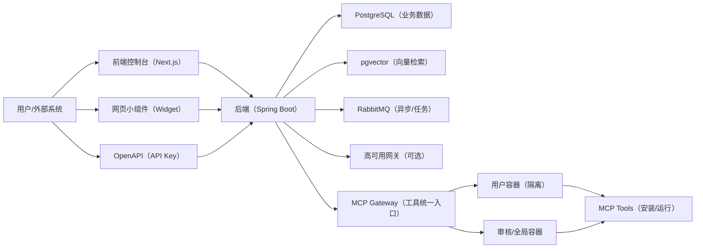

<!--
说明：
1) 本文件用于撰写/整理毕业论文内容草稿（Markdown）。
2) 内容基于本仓库源码与文档梳理而来，重点解释“AgentX 是什么、亮点、难点、关键实现”。
3) 你可以按学校模板删改章节、补充封面/致谢/附录/格式要求。
-->

# 基于大语言模型与 MCP 的智能 Agent 构建平台设计与实现 —— AgentX

## 摘要

随着大语言模型（LLM）在问答、写作与代码生成等场景中广泛应用，传统“纯聊天机器人”逐渐无法满足企业与个人对“可控、可扩展、可集成”的智能体需求。本毕业设计实现了一个面向多用户的智能 Agent 构建平台 AgentX。平台以 Spring Boot 3（Java 17）为后端核心，配套 Next.js 前端控制台，围绕“Agent 配置（提示词/工具/知识库）— 会话管理 — 流式对话 — 工具调用 — RAG 检索增强 — 长期记忆 — 计费与审计 — 监控追踪”的完整链路进行工程化落地。

在能力集成方面，本项目引入 MCP（Model Context Protocol）作为工具统一接入协议，通过 MCP Gateway + 容器隔离的方式为用户提供可部署、可复用、可审计的工具调用能力；在对话可靠性方面，设计并实现了 Token 超限处理策略（无策略/滑动窗口/摘要）以保证长对话稳定运行；在知识增强方面实现 RAG 问答流程，严格约束回答必须基于检索文档，降低幻觉风险；在系统可观测性方面实现执行链路追踪，记录高可用模型调度、工具调用、Token 与计费等关键指标，支持问题定位与成本透明。实践表明，AgentX 能够以较低的使用门槛支持用户创建并发布可调用工具与知识库的智能体，并通过开放 API 与网页小组件形式对外提供服务。

**关键词**：大语言模型；Agent；MCP；工具调用；RAG；流式对话；链路追踪；计费系统；Spring Boot

## Abstract（可选）

This thesis designs and implements AgentX, a multi-tenant Agent-building platform powered by Large Language Models (LLMs) and the Model Context Protocol (MCP). AgentX provides an end-to-end workflow including agent configuration, session management, streaming chat, tool invocation via MCP with container isolation, retrieval-augmented generation (RAG), long-term memory extraction, billing & audit, and execution tracing. The system is built with Spring Boot 3 (Java 17) and a Next.js frontend, emphasizing extensibility, reliability under token limits, observability, and cost transparency.

**Keywords**: LLM; Agent; MCP; Tool Calling; RAG; Streaming; Tracing; Billing; Spring Boot

---

## 第 1 章 绪论

### 1.1 研究背景与意义

大语言模型具备强大的自然语言理解与生成能力，但“把模型接进一个 Web 接口”并不等于“可用的智能系统”。实际落地通常会遇到如下问题：

- **业务能力缺失**：模型本身不会访问企业系统、数据库、工单、网页等外部能力，必须通过“工具”扩展。
- **知识不更新/幻觉风险**：模型可能编造答案，需要通过检索增强（RAG）或明确的 grounding 机制降低幻觉。
- **上下文窗口限制**：长对话会超出 Token 上限，导致报错或遗忘关键信息，需要上下文压缩与管理策略。
- **成本与稳定性**：模型调用有成本且可能不稳定，需要计费、限流、高可用调度与故障降级。
- **可观测性不足**：当 Agent 表现异常时，缺乏执行链路与证据，难以排查是模型、工具还是上下文问题。

因此，构建一个“可配置、可集成、可监控、可计费”的 Agent 平台具有显著工程价值。本项目以“传统 Java 后端可理解的工程化方式”实现上述能力，为后续的功能扩展（多 Agent、知识图谱等）提供基础框架。

### 1.2 国内外现状简述（写作建议）

本节可从三条线展开：

1. **对话系统工程化**：从传统 NLP 聊天机器人到 LLM Chat 服务端工程。
2. **工具调用范式**：从 function calling / plugins 到 MCP 的统一协议化接入。
3. **RAG 与记忆**：从向量检索、embedding 存储，到会话摘要、长期记忆抽取。

由于本科论文通常不要求非常全面，可用“概念 + 典型系统/框架 + 本项目选择原因”的方式完成。

### 1.3 研究内容与论文结构

本论文的研究与实现内容包括：

- 设计 AgentX 的总体架构与分层（DDD：interfaces/application/domain/infrastructure）。
- 实现对话链路：环境准备、会话管理、SSE 流式输出、同步输出。
- 集成 MCP 工具调用：工具市场、工具部署、容器隔离与 MCP Gateway URL 生成。
- 实现 RAG：检索、拼接上下文、流式回答、文档引用回传。
- 实现 Token 超限策略：滑动窗口与摘要。
- 实现长期记忆抽取：对用户发言抽取“可复用要点”，异步落库。
- 实现高可用模型调度与调用结果上报。
- 实现计费：商品-规则解耦 + 策略模式 + 用量记录。
- 实现链路追踪：记录模型调用、工具调用与关键耗时指标。

---

## 第 2 章 需求分析

### 2.1 角色与使用场景

AgentX 的典型角色可归纳为：

- **普通用户**：创建/配置 Agent，选择模型、配置工具、绑定知识库；进行对话与复盘执行链路。
- **管理员**：管理全局工具、审核/发布资源、维护系统配置与计费规则等。
- **外部系统调用方**：通过 OpenAPI（API Key）发起对话，集成到其他产品中。
- **网站运营方**：通过网页小组件（Widget）在自己的站点嵌入对话能力。

### 2.2 功能性需求（概括）

结合仓库 README 与后端接口设计，功能需求可概括为：

1. **Agent 管理**：创建、编辑、启用/禁用、发布版本；配置 system prompt、欢迎语、工具、知识库等。
2. **会话与消息管理**：创建会话、查询消息、重命名会话、流式/同步聊天。
3. **工具接入与调用**：工具市场；通过 MCP 协议统一接入；支持工具预设参数；支持全局工具与用户隔离工具。
4. **RAG 知识库问答**：文档解析、向量化、检索召回、基于文档回答与引用展示。
5. **Token 上下文管理**：滑动窗口与摘要策略。
6. **长期记忆**：对用户发言抽取可复用信息并注入后续对话。
7. **高可用与降级**：当模型/服务商不稳定时，支持会话亲和性与降级链路。
8. **计费与审计**：按 Token / 按次等规则计费；记录用量与扣费。
9. **监控与追踪**：可视化展示一次对话的执行链路与技术细节。
10. **开放能力**：OpenAPI + Widget 嵌入。

### 2.3 非功能性需求（概括）

- **可扩展性**：工具接入需标准化；计费规则可扩展；RAG 检索策略可扩展。
- **可靠性**：流式响应稳定；高可用调度与结果上报；错误可定位。
- **安全性**：API Key 鉴权；工具调用与容器隔离；敏感信息屏蔽。
- **性能**：流式输出降低等待；异步记忆抽取减少主链路开销。
- **可维护性**：DDD 分层 + Assembler 转换规范 + 文档化。

---

## 第 3 章 总体设计

### 3.1 系统总体架构

AgentX 是一个“后端编排 + 前端控制台 + 运维部署”的完整系统：

- **后端（AgentX 模块）**：Spring Boot 3.2.3、Java 17、MyBatis-Plus、PostgreSQL；对话与 Agent 编排、MCP 工具接入、RAG、计费、追踪等核心逻辑均在此实现。
- **前端（agentx-frontend-plus）**：Next.js 15 + TypeScript；提供 Agent 配置、对话 UI、执行链路查看、管理后台等页面。
- **部署与依赖**：Docker Compose 脚本支持一键启动（含 DB、MQ 等）。

可用下图描述逻辑架构（论文中可作为“系统架构图”）：

### 3.2 后端分层架构（DDD）

后端代码目录清晰遵循 DDD 分层规范（可作为论文“软件架构设计”的亮点之一）：

- `org.xhy.interfaces`：控制器与对外 API（如 WidgetChatController、OpenController）。
- `org.xhy.application`：应用服务（AppService），负责流程编排、DTO 组织与事务边界。
- `org.xhy.domain`：领域模型与领域服务（Entity、Aggregate、DomainService），承载核心业务规则。
- `org.xhy.infrastructure`：基础设施能力（存储、外部网关、LLM 客户端、MCP 网关、配置、工具类等）。

这种结构对“传统 Java 后端开发者”很友好：Agent 并不是“神秘的 AI 模型训练”，而是一个可拆分为多个业务模块的工程系统。

### 3.3 核心数据设计（概述）

核心数据对象可归纳为：

- **Agent**：名称、描述、system prompt、工具列表、知识库列表、发布版本等（见 `agents` 表与 `AgentEntity`）。
- **会话与消息**：Session、Message、Context（active_messages、summary 等），支撑上下文管理与长对话策略。
- **工具与容器**：Tool（serverName、installCommand、全局/用户隔离标记等）与 Container（用户容器/审核容器）。
- **RAG**：知识库、文档单元、向量索引/向量存储（pgvector）。
- **计费**：Product（商品）、Rule（规则）、UsageRecord（用量记录）、Account（账户余额）。
- **追踪**：执行 trace、模型调用记录、工具调用记录等。

（写作建议：可结合 `docs/sql/01_init.sql` 抽取 6~10 张核心表画 ER 图。）

---

## 第 4 章 关键技术与实现

本章是论文的“核心亮点”章节。建议写作方式：先讲“为什么需要”，再讲“总体流程”，再给“关键类/模块位置”，最后总结“实现效果”。

### 4.1 Agent 开发到底是什么？（面向传统 Java 后端的解释）

在本项目中，“Agent 开发”主要不是训练模型，而是**对模型能力进行工程化编排**，包括：

- 用 **system prompt** 约束模型角色与输出格式；
- 给模型提供“可调用的工具”（例如搜索、文件处理、业务查询），工具由平台统一管理；
- 给模型提供“可检索的知识库”（RAG），使回答基于企业/个人文档；
- 管理对话上下文（Token 限制、摘要、窗口）；
- 将上述过程做成可观测、可计费、可对外开放的服务。

因此，AgentX 的核心价值在于：把“LLM + 工具 + 知识 + 记忆 + 监控 + 成本”组合为一个可落地的平台能力。

### 4.2 对话链路与流式响应（SSE）

#### 4.2.1 统一对话入口与环境准备

对话入口由 `ConversationAppService` 统一处理，核心工作包括：

1. 获取会话与 Agent 配置；
2. 解析 Agent 绑定的工具（MCP serverNames）与知识库；
3. 选择模型与服务商，并接入高可用调度与降级；
4. 创建 `ChatContext`，交给不同的消息处理器（标准 Agent / RAG）。

相关类位置：

- 对话应用服务：`AgentX/src/main/java/org/xhy/application/conversation/service/ConversationAppService.java`
- 处理器工厂：`AgentX/src/main/java/org/xhy/application/conversation/service/handler/MessageHandlerFactory.java`

#### 4.2.2 流式输出的工程实现

为了提升交互体验，AgentX 默认采用 SSE（Server-Sent Events）进行流式输出：

- 后端通过 `SseEmitter` 与 `TokenStream` 回调逐步发送模型生成的片段；
- 同时支持同步接口，便于外部系统在非流式场景下快速集成。

相关实现入口：

- Widget 流式聊天：`AgentX/src/main/java/org/xhy/interfaces/api/public_api/WidgetChatController.java`
- OpenAPI 流式/同步：`AgentX/src/main/java/org/xhy/interfaces/api/external/OpenController.java`
- 抽象处理器模板：`AgentX/src/main/java/org/xhy/application/conversation/service/message/AbstractMessageHandler.java`

**难点与解决**：

- 难点：流式回调跨线程/异步执行，追踪上下文与异常处理不易统一。
- 解决：通过 `TracingMessageHandler` 在关键回调（onPartialResponse/onToolExecuted/onError 等）包装 ThreadLocal 上下文，保证“同一条对话 trace”贯穿整个调用链（见 `TracingMessageHandler`）。

### 4.3 工具调用：MCP + 容器隔离（项目核心亮点）

#### 4.3.1 为什么选择 MCP

如果每个工具都通过“自定义 HTTP 接口”接入，会导致：

- 工具协议不统一，参数/返回值格式不一致；
- 难以标准化管理（发现、调用、鉴权、审计）；
- 很难在平台层实现“工具市场”与“可插拔扩展”。

本项目引入 MCP（Model Context Protocol）作为工具调用的统一协议：后端只需要连接 MCP Server，即可发现并调用工具，从而把工具生态变成可扩展模块。

#### 4.3.2 工具提供者与 MCP 客户端构建

AgentX 使用 LangChain4j 的 MCP 客户端能力构建 `ToolProvider`：

- `AgentMessageHandler` 通过 `provideTools()` 提供本轮对话可用的工具集合；
- `AgentToolManager` 为每个 MCP serverName 创建 `McpClient`，并组装为 `McpToolProvider`。

相关类位置：

- `AgentX/src/main/java/org/xhy/application/conversation/service/message/agent/AgentMessageHandler.java`
- `AgentX/src/main/java/org/xhy/application/conversation/service/message/agent/AgentToolManager.java`

#### 4.3.3 “用户隔离工具”与“全局工具”的统一接入

AgentX 在平台层进一步做了工程化增强：通过 `McpUrlProviderService` 自动判断工具类型并生成连接 URL：

- **全局工具**：连接到审核容器（预装/可信环境）。
- **用户工具**：为用户准备独立容器，按需部署工具，再通过 MCP Gateway 进行连接。

这部分实现让工具调用具备多租户隔离与可控性，是本项目相对“普通聊天系统”的明显升级。

相关类位置：

- `AgentX/src/main/java/org/xhy/application/conversation/service/McpUrlProviderService.java`

**难点与解决**：

- 难点 1：多用户并发调用工具时的环境隔离与部署时序（先容器就绪、再部署、再连接）。
- 难点 2：MCP SSE 连接超时、网络抖动与错误恢复。
- 解决：将 URL 构建、容器准备、工具部署职责集中到 `McpUrlProviderService`，在失败时抛出业务异常并在上层记录追踪数据；同时在工具层面支持预设参数（PresetParameter）减少运行时参数缺失。

### 4.4 RAG：检索增强与“基于文档回答”的约束

RAG（Retrieval-Augmented Generation）用于解决“模型不知道你的私有文档/容易幻觉”的问题。AgentX 的 RAG 流程分两阶段：

1. **检索阶段**：根据用户问题从知识库召回相关文档片段；
2. **生成阶段**：将检索到的 `<context>` 注入 system prompt，要求模型“严格且仅根据 context 回答”，并在无资料时拒答。

相关实现位置：

- RAG 消息处理器：`AgentX/src/main/java/org/xhy/application/conversation/service/message/RagMessageHandler.java`

**亮点**：

- 使用明确的“grounding 规则 + 拒绝机制”提示词，降低幻觉；
- RAG 流式输出中区分“思考过程/回答过程/引用文档”，便于前端更好展示（MessageType 区分）。

**难点与解决**：

- 难点：检索结果质量不稳定会直接影响回答质量，且需要避免模型“脱离文档自由发挥”。
- 解决：在 system prompt 中强制 grounding；当无召回文档时给出明确提示；在 UI 层展示检索到的文档列表作为可解释性证据。

### 4.5 Token 超限处理：滑动窗口与摘要策略（长对话稳定性）

LLM 上下文窗口有限，长对话必然遇到 Token 超限。本项目通过 Token 策略解决长对话可持续性问题：

- **无策略**：不处理，适合短对话；
- **滑动窗口**：丢弃最老消息，保留最新消息；
- **摘要**：把早期消息生成摘要并累计到 `context.summary`，再保留近期消息。

实现要点：

- 上下文由 `ContextProcessor` 负责处理，依赖 `TokenDomainService` 对消息进行 Token 计算与策略裁剪；
- 摘要策略会把新摘要追加到旧摘要中，并更新 `active_messages`。

相关类位置：

- `AgentX/src/main/java/org/xhy/domain/conversation/service/ContextProcessor.java`
- 方案文档：`docs/token_overflow_strategy.md`

**难点与解决**：

- 难点：摘要需要额外模型调用，带来延迟与成本；滑动窗口会丢失关键背景。
- 解决：提供可配置策略，让不同类型 Agent 选择合适方案；在论文中可对比三种策略的优缺点与适用场景。

### 4.6 长期记忆：对话后抽取“可复用要点”

为了让 Agent 在多轮对话中更“懂用户”，AgentX 设计了长期记忆能力：

- 在对话成功完成后，异步触发 `MemoryExtractorService.extractAndPersistAsync()`；
- 只基于“本轮用户发言”抽取 PROFILE/TASK/FACT/EPISODIC 四类记忆；
- 设定严格的不抽取规则（例如一次性命令、隐私信息、敏感凭据等），并只保存高重要度记忆；
- 以 XML 结构化输出，后端解析后落库。

相关类位置：

- `AgentX/src/main/java/org/xhy/domain/memory/service/MemoryExtractorService.java`
- 在对话完成钩子触发：`AgentX/src/main/java/org/xhy/application/conversation/service/message/AbstractMessageHandler.java`

**难点与解决**：

- 难点：记忆抽取如果不加约束会带来隐私风险与噪声；若同步执行会拖慢主对话链路。
- 解决：强约束提示词（禁止抽取隐私/一次性请求）+ 异步执行（降低主链路延迟）。

### 4.7 高可用模型调度与降级链路（可靠性）

LLM 服务可能不稳定或成本差异显著。AgentX 支持通过“高可用网关”进行实例选择：

- 支持会话亲和性（同一 session 尽量命中同一实例，减少波动）；
- 支持降级链（当主模型不可用时自动切到候选模型）；
- 上报调用成功/失败、延迟等数据，形成闭环调度。

相关类位置：

- 接口：`AgentX/src/main/java/org/xhy/domain/llm/service/HighAvailabilityDomainService.java`
- 实现：`AgentX/src/main/java/org/xhy/domain/highavailability/service/HighAvailabilityDomainServiceImpl.java`

### 4.8 计费系统：商品-规则解耦 + 策略模式（成本可控）

为了让平台具备“可运营性”，AgentX 将计费设计为可扩展的通用能力：

- **商品 Product**：声明“对什么收费”，包含定价配置；
- **规则 Rule**：声明“怎么收费”，通过 handler_key 映射到策略实现；
- **策略 Strategy**：按 Token、按次等计费算法；
- **用量记录 UsageRecord**：记录每次可计费事件，支持审计；
- **账户 Account**：余额检查与扣费。

相关类位置：

- `AgentX/src/main/java/org/xhy/application/billing/service/BillingService.java`
- 设计文档：`docs/billing/计费.md`

**难点与解决**：

- 难点：计费必须可扩展且可审计；并发下要避免重复扣费。
- 解决：策略模式解耦计算逻辑；通过 requestId 做幂等校验；费用为 0 也记录用量，保证审计链完整。

### 4.9 执行链路追踪：让 Agent “可解释、可排障”

Agent 系统的“难调试”是工程痛点。AgentX 通过链路追踪把一次对话拆解成多个阶段（环境准备、模型调用、工具调用、计费上报等），并记录关键数据：

- 本次使用的模型与服务商是否发生切换（高可用调度）；
- Token 使用与费用；
- 工具调用序列、参数与结果；
- 各阶段耗时、首 token 时间等指标；
- 出错阶段与错误原因。

相关位置：

- 追踪处理器：`AgentX/src/main/java/org/xhy/application/conversation/service/message/TracingMessageHandler.java`
- 追踪需求文档：`docs/monitoring/agent-execution-trace-requirements.md`

---

## 第 5 章 系统亮点与难点总结（论文写作可直接引用）

### 5.1 项目亮点（可作为“创新点/特色功能”）

1. **MCP 工具生态 + 容器隔离的工程化组合**：通过 MCP 协议统一工具接入，并结合用户容器/审核容器实现多租户隔离、按需部署与可控调用。
2. **面向长对话的 Token 超限策略**：提供滑动窗口与摘要策略，保证对话在上下文限制下可持续运行。
3. **RAG 严格 grounding 与拒答机制**：强制答案仅基于检索文档，减少幻觉并提升可解释性。
4. **长期记忆抽取（异步）**：将“用户偏好/目标/稳定事实”结构化提取并落库，提升后续对话个性化。
5. **高可用模型调度与降级链路**：支持会话亲和性、故障降级与结果上报形成调度闭环。
6. **可运营的计费系统**：商品-规则解耦 + 策略模式 + 幂等校验 + 用量记录，支撑成本可控与审计。
7. **执行链路追踪**：把 Agent 的“黑盒”过程变成可视化的阶段链路，便于排障、优化与成本透明。
8. **多种对外形态**：控制台对话、开放 API、网页小组件三种形式满足不同集成场景。

### 5.2 项目难点（及应对思路）

1. **流式对话的线程上下文与错误处理**  
   - 难点：LLM 的流式回调天然异步，统一追踪、统一异常处理与资源释放不容易。  
   - 应对：以模板方法封装对话流程，并在回调包装追踪上下文，确保链路一致。

2. **工具调用的稳定性与隔离性**  
   - 难点：工具调用涉及网络连接、容器状态、工具安装时序与超时控制；多租户场景下必须隔离。  
   - 应对：URL 生成与容器准备集中管理；区分全局/用户工具；在失败时可追踪与可提示。

3. **RAG 质量与幻觉控制**  
   - 难点：召回质量波动会导致回答质量不稳定；模型容易引入外部知识。  
   - 应对：采用严格 grounding prompt；无文档时拒答；展示检索文档作为证据链。

4. **Token 限制下的上下文保真**  
   - 难点：滑动窗口丢信息、摘要会失真且引入成本。  
   - 应对：策略可配置；摘要累积；在论文中可通过实验对比策略效果与成本。

5. **记忆抽取的隐私与噪声控制**  
   - 难点：记忆若不受控会记录敏感信息或无价值内容。  
   - 应对：强约束提示词 + importance 阈值 + 异步执行。

6. **计费准确性与幂等性**  
   - 难点：并发下重复扣费风险；费用计算与记录需要可审计。  
   - 应对：requestId 幂等；用量记录与扣费解耦；策略模式便于扩展。

---

## 第 6 章 测试与结果（建议写法）

（本仓库前端缺省测试框架时，可用“后端单元测试 + 接口联调验证 + 关键场景手工测试”来完成论文测试章节。）

### 6.1 测试环境

- 后端：Spring Boot 3 / Java 17 / Maven
- 数据库：PostgreSQL（含向量检索扩展 pgvector）
- 消息队列：RabbitMQ（如启用相关功能）
- 部署：Docker Compose 一键启动

### 6.2 功能测试用例（示例）

1. **标准对话**：创建 Agent（仅 system prompt），新建会话，进行流式对话，验证消息保存与流式输出。
2. **工具调用**：为 Agent 绑定 MCP 工具，发起包含工具需求的问题，验证工具被调用、结果被模型引用并返回。
3. **RAG 问答**：上传/绑定知识库文档，提问文档内问题，验证返回内容与引用文档一致；提问文档外问题应拒答。
4. **Token 超限**：构造长对话触发滑动窗口/摘要，验证 active_messages 更新与摘要生成。
5. **长期记忆**：输入用户偏好（例如“以后都用中文回答”），验证被抽取并存储（可通过后台查看）。
6. **计费**：开启计费规则，发起对话，验证扣费与用量记录生成；余额不足时给出提示。
7. **追踪**：打开执行链路展示，验证模型选择/工具调用/Token/费用/耗时等数据可查询。

### 6.3 性能与可用性指标（建议）

- 首 token 响应时间（TTFB）
- 平均 tokens/s
- 工具调用成功率与平均耗时
- RAG 检索耗时与召回数量

---

## 第 7 章 总结与展望

### 7.1 总结

本毕业设计完成了一个面向多用户的智能 Agent 构建平台 AgentX 的设计与实现。系统以 DDD 分层提升可维护性，通过 SSE 实现流式对话体验；在能力层面，结合 MCP 与容器隔离实现可插拔工具生态，结合 RAG 与严格 grounding 提升知识问答可靠性；在工程化方面，支持 Token 超限策略、长期记忆抽取、高可用调度、计费与执行链路追踪，为 Agent 的可落地性提供支撑。

### 7.2 展望

可进一步开展的工作包括：

1. **Multi-Agent 协作**：引入多智能体分工与协调机制，支持更复杂任务。
2. **知识图谱**：将结构化知识与 RAG 结合，提高复杂推理与关系查询能力。
3. **更强的工具治理**：工具权限、沙箱强化、审计报表、工具版本管理与灰度发布。
4. **自动评测与质量监控**：对回答准确率、RAG grounding、工具调用成功率建立持续评测体系。

---

## 参考文献（占位，按学校要求补全）

1. Spring Boot 官方文档  
2. LangChain4j 官方文档（含 MCP 支持）  
3. PostgreSQL & pgvector 相关资料  
4. RAG 相关经典论文/综述（可选）  
